# Reconsidering Cosmic Dualism: A Two-Realm Framework

**John Glen Nicholson**

## Table of Contents

- [1. Introduction and Intentions](#1-introduction-and-intentions)
- [2. Forms and Things](#2-forms-and-things)
- [3. Asymmetric and Opposite](#3-asymmetric-and-opposite)
- [4. Thermodynamics and Entropy](#4-thermodynamics-and-entropy)
- [5. Special Relativity and General Relativity](#5-special-relativity-and-general-relativity)
- [6. Quantum Mechanics and Information](#6-quantum-mechanics-and-information)
- [7. Particles and Pilot Waves](#7-particles-and-pilot-waves)
- [8. Dark Matter and Dark Energy](#8-dark-matter-and-dark-energy)
- [9. Superfluid and Bubbles](#9-superfluid-and-bubbles)
- [10. Geometry and Symmetry](#10-geometry-and-symmetry)
- [11. Curvature and the Sine Wave](#11-curvature-and-the-sine-wave)
- [12. Beyond the Standard Model and the Big Bang Theory](#12-beyond-the-standard-model-and-the-big-bang-theory)
- [13. Dual and Cyclic Cosmology](#13-dual-and-cyclic-cosmology)
- [14. Halos and Filaments; Black Holes and Bridges](#14-halos-and-filaments-black-holes-and-bridges)
- [15. Postulates, Equations and Tests](#15-postulates-equations-and-tests)
- [16. Conclusion and Discussion](#16-conclusion-and-discussion)
- [Citations and References](#citations-and-references)

## Reconsidering Cosmic Dualism, A Two-Realm Framework

John Glen Nicholson  
*Information Physics Institute*  
Long Beach, California, USA  
jgnbpca@hotmail.com

***Research Question*:** What is the simplest theory that can be constructed that simultaneously addresses the largest number of unsolved problems left in physics?

### Abstract

This paper proposes a two-realm cosmological framework in which the observable Universe is paired with an Oppoverse governed by complementary physical properties. The model treats the combined system, termed the Dualverse, as conserving mass, energy and information across both realms. Within this framework, black hole singularities are interpreted as transitions between realms; dark matter is modeled as negative-mass antimatter in a separate frame of reference; and dark energy is modeled as differential vacuum pressure. The paper further applies information physics and a nonlocal pilot-wave interpretation to quantum uncertainty, entanglement and the black hole information paradox. The postulates are collected as equations in Section 15, together with the observations that currently constrain them: the dark-matter fraction required at recombination, the photon-to-baryon ratio, the DESI DR2 dark-energy constraints, the ALPHA antihydrogen gravity measurement, the cluster bounds on dark-matter self-interaction and the neutron lifetime measurements. These proposals are developed as hypotheses rather than established results and are assessed by their internal consistency, explanatory scope and observational consequences.

**Keywords:** Dualism; Dualverse; Dark energy; Cosmological constant; Oppoverse; Dark matter; Baryon asymmetry; Entropy; Conservation laws; Klein bottle; Cyclic model; Singularity; Black hole information paradox; Dirac hole theory; Quantum nonlocality; Hidden variable theory; Pilot-wave theory; Back-reaction; Two-state vector formalism; Torsion.

### Definitions

**Oppoverse** = the antimatter realm with complementary laws of physics, observed from our side as the "dark" components of the data; also called the Realm of Forms.

**Dualverse** = our known Universe and the Oppoverse described as one mutualistic system.

**Singularity** = the transition between the two realms: when torsion forces geodesics closer together than the Planck length, they twist inside out.

**Forms** = perfect geometry, universal mathematics, the (anti)sampling source, the fine-tuned constants.

**U⁺, U⁻** = our Universe and the Oppoverse respectively, as used in equations.

## 1. Introduction and Intentions

The Standard Model accurately describes the known elementary particles and three fundamental interactions, but it does not include gravity or identify the nature of dark matter. General relativity accurately describes gravitation across a wide range of tested conditions, yet its classical solutions contain singularities where the theory ceases to provide a complete physical account. Quantum mechanics is exceptionally predictive, although its interpretation and its reconciliation with gravity remain unsettled. This paper asks whether a two-realm framework can connect these unresolved problems without discarding the successful predictions of the existing theories.

The theory begins from a small set of assumptions and develops into a network of consequences. Simplicity is used here as a design constraint: the preferred framework is the one that introduces the fewest independent assumptions while addressing the widest range of observations. Feynman's remarks on simplicity [1] motivate this aim, but simplicity alone cannot establish truth; the model must also be internally consistent, recover the successful existing theories in their tested domains, and produce testable consequences.

Roadmap: Sections 2–4 define the Dualverse postulates and the proposed conservation relations. Sections 5–7 develop the suggested links to relativity, quantum mechanics and pilot-wave theory. Sections 8–11 apply the framework to dark matter, dark energy, fluid analogies and geometry. Sections 12–14 extend the model to early-universe cosmology, cyclic evolution, black holes, halos and filaments. Section 15 collects the postulates as equations and confronts them with current measurements. Section 16 summarizes the framework's explanatory claims and the work required to test it.

The framework is developed around five connected problem areas: singularities and black-hole information; dark matter and dark energy; the low-entropy and horizon conditions of the early Universe; quantum uncertainty and entanglement; and the possibility of cyclic cosmological evolution. Later sections discuss additional phenomena as possible implications. None of the items below should be treated as explained unless the model supplies a mechanism and a discriminating prediction; the list records the questions the framework is aimed at.

1. The unknown physics of the black hole and Big Bang singularities.
2. The unknown physics of dark matter and dark energy.
3. The open problems of inflationary cosmology [2].
4. The black hole information paradox.
5. The quantum entanglement paradox.
6. The basis of the Heisenberg uncertainty relation.
7. The low entropy of the very early Universe.
8. The baryon asymmetry.
9. The flatness problem.
10. The horizon problem.
11. The cosmological constant problem.
12. The relation between supermassive black hole mass and galaxy velocity dispersion.
13. The relation between relativistic jets and their accretion disks.
14. The origin and future of our fine-tuned Universe.
15. The origin of the largest observed structures, at scales above 10⁹ light years.
16. The sources of ultra-high-energy cosmic rays.
17. The missing magnetic monopoles.
18. The disagreement between beam and bottle measurements of the neutron lifetime.

This paper develops the model from a small set of assumptions and compares its implications with established observations and unresolved problems. The analysis is exploratory: cited evidence may motivate or constrain a hypothesis, but it does not confirm the hypothesis unless a distinct prediction follows. Bayesian language is used qualitatively to compare explanatory scope, consistency with prior knowledge and predictive risk; no numerical posterior probabilities are claimed.

The Dualverse is presented as a speculative organizing framework, not as a completed physical theory. Its value depends on whether its assumptions can be expressed mathematically, whether it reproduces established results in their tested domains, and whether it yields predictions that differ from standard cosmology. The strongest version of the argument therefore requires three things: a defined mapping between the two realms, conservation equations for the combined system, and at least one observation capable of falsifying the model. Section 15 supplies a first version of all three.

## 2. Forms and Things

Plato's distinction between Forms and things provides a philosophical analogy for the proposed two-part model, but it does not constitute physical evidence for that model. In the Dualverse framework, "Forms" denotes exact mathematical information assigned to the Oppoverse, while "things" denotes observable mass-energy structures in our Universe. The physical proposal begins only when these categories are given defined states, interactions and conservation relations. The paper therefore treats Platonic dualism as motivation and terminology.

Mach's principle, in the form in which the local inertial frame is determined by the distribution of all the mass in the Universe [3], is relevant to the model in the following way: if the two realms are decoupled, each carries its own inertial standard, and the two standards move in opposite directions simultaneously. Section 13 develops this decoupling.

The regularities that mathematics captures in nature, from the Fibonacci sequence to fractal patterns, are taken here as a hint that an exact structure stands behind the approximate one we measure. Bohm and Hiley describe particles, objects and even subjects as semi-autonomous, quasi-local features of an underlying activity, independent of that activity only up to a certain level of approximation [4]. Cosmologists who follow Everett argue that there may be many or even infinitely many realms [5, 6]. Diverging from the many-worlds approach, this paper argues for at least two realms, but not necessarily many.

The divide and interaction between the pair of realms is described as the singularity, which can also be described as a special type of pivot point. These realms must be asymmetric in nearly every way in our model. It is not strange that we cannot see or calculate the Realm of Forms directly: we exist in a different, separate frame of reference. We can only see one side of a coin at a time, yet we can be certain that the other side exists. Einstein's remark that behind all the discernible laws and connections "there remains something subtle, intangible and inexplicable" [7] names the thing this paper tries to make tangible by argument.

## 3. Asymmetric and Opposite

Newton's third law, that every force is accompanied by an equal and opposite reaction force, is the inspiration for the model's central postulate.

**Postulate P1 (pairing).** For every Universe there exists an opposite Universe with corresponding laws and content: for every U⁺ that exists there is a U⁻ that must exist, ∀ U⁺ ∃ U⁻. The pair is asymmetric in a fundamental way: |U⁺| ≠ |U⁻| in total content, as developed in the previous section.

If the Higgs field [8] is described as a positive scalar field H⁺, the postulate suggests an opposite, balancing scalar field H⁻ whose effects we observe as dark matter and dark energy and which plays the role that an inflaton field plays in standard cosmology. The Higgs boson is its own antiparticle. In this framework the flow of time is opposite for antimatter, which is why antimatter is observed to gravitate normally (Section 5). The gravitational potential is then the potential of the combined field that develops between the two.

Constructor theory offers a useful way of speaking. Deutsch and Marletto propose expressing all physical laws in terms of which transformations are possible and which are impossible, and why [9, 10]. In that language, the framework's claim is that the sets of possible and impossible transformations are complementary between the two realms: what is impossible in our Universe is possible in the Oppoverse, and vice versa. To define something definite, we first need its absence as a reference; to define the laws of physics, we implicitly define the opposite laws.

Newton's law of gravitation,

F = G m₁m₂ / r², G = 6.674 × 10⁻¹¹ m³ kg⁻¹ s⁻²,

describes what we see in the solar system to high accuracy, and general relativity supplies the small corrections. Many cosmologists expect a theory of everything from string theory or from many-worlds quantum mechanics; that is not the direction of this paper, though there may be shared elements. If string theory or many worlds trouble the reader, the terms used here (Universe, Oppoverse, Dualverse) are the model's own and should not be confused with other predefined notions. The whole dual system is modeled as one four-dimensional manifold [11, 12], of which we describe different and partly unknown parts. There may be an equivalent higher-dimensional description; a recent example is the (5+1)-dimensional model of Greene, Kabat, Levin and Porrati, in which a non-orientable Klein bottle factor breaks CP and may generate the matter-antimatter asymmetry [13]. This paper favors the simpler picture. The non-orientable surface itself is Felix Klein's 1882 construction [14].

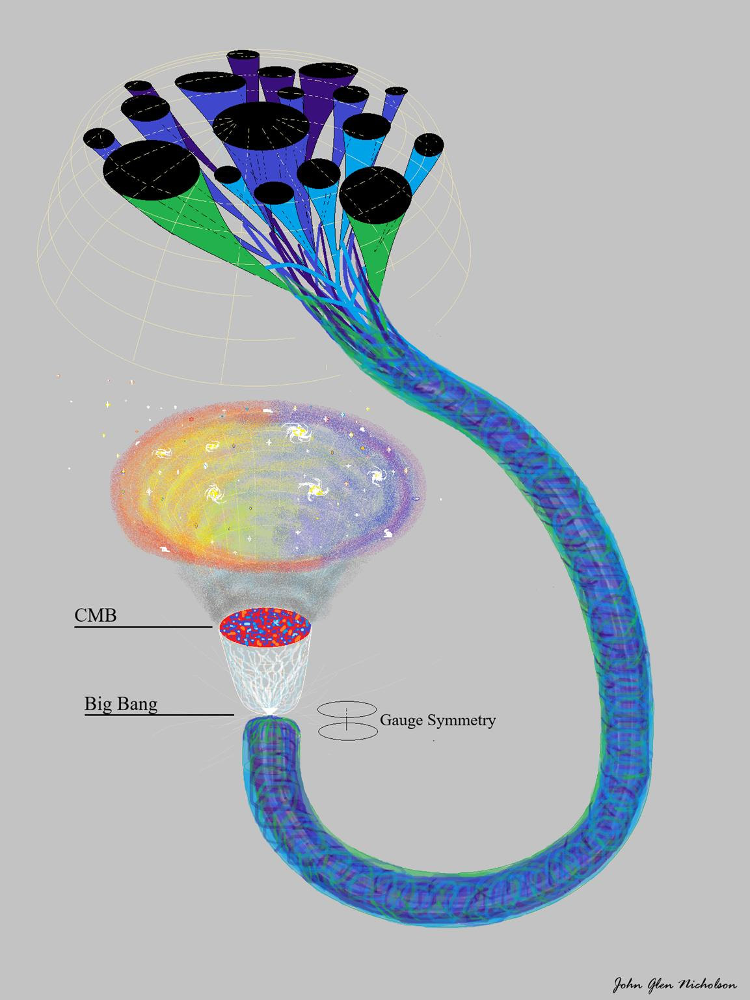

*Figure 3.1. Klein bottle Dualverse (schematic).*

The Oppoverse might be represented by one surface of this manifold. From an outside perspective of the Dualverse it is difficult to distinguish whether these are two individual things bound together or two parts of one thing. A Klein bottle gives two non-interacting surfaces within a three-dimensional shape, making use of the inside geometry; it needs no extra dimensions.

## 4. Thermodynamics and Entropy

Émilie du Châtelet argued, on the basis of 's Gravesande's collision experiments, that the quantity conserved in collisions is proportional to mv², the forerunner of kinetic energy [15]. This outline predicts a Dualverse in which mass, energy and information are interchangeable and jointly conserved, as a function of time. Mass is conserved as energy in U⁺. Mass and energy are conserved as information and energy in U⁻. Together, the first law is preserved for the Dualverse.

**Postulate P2 (extended first law).** Neither energy, mass nor Formal Information may be created or destroyed in U⁺. Work done in U⁺ never produces Formal Information. Work done in U⁻ produces Formal Information.

**Postulate P3 (extended second law).** While the total entropy of U⁺ increases, the entropy of U⁻ decreases:

ΔS⁺ ≥ 0 and ΔS⁻ ≤ 0, with ΔS⁺ + ΔS⁻ ≈ 0.

The proposed balance is a model constraint to be derived and tested, not an established consequence of thermodynamics.

In this recycling system, form becomes structure and structure becomes form, with the same matter and energy equivalents circulating so that the second law is always observed on our side. If the arrow of time were a ray, adding its opposite would give a straight line; in this model it gives a closed curve. Stable matter is treated as an entanglement of three or more spatial degrees of freedom: the proton is the bound state of two up quarks and one down quark, and the neutron of one up and two down quarks, the neutron being unstable in isolation. In this view entropy counters gravity, gravity being the action and entropy the reaction in the sense of Newton's third law.

**Postulate P4 (pressure-volume balance).** Boyle's law for an ideal gas at fixed temperature and amount, P₁V₁ = P₂V₂, is extended to the pair of realms: the pressure-volume product of U⁻ equals that of U⁺,

P⁻V⁻ = P⁺V⁺.

Just as infinite energy densities are excluded later, infinite pressures and volumes are excluded here. Section 5 relates this balance to the cosmological constant and dark energy.

The combined Dualverse is proposed as a closed system in which the two realms exchange mass-energy and information. For this claim to be meaningful, the model must define the exchange variables, the direction and rate of transfer, and the conditions under which the total remains conserved. The asymmetry between the realms cannot be justified by analogy alone; it must be represented by explicit state functions or dynamical equations (Section 15). Klein-bottle geometry provides a visualization of continuity between the realms, but the geometry does not by itself establish the conservation mechanism.

Black holes are central to the model's picture of entropy and conservation. Usually a large mass with its gravity forms a low-entropy macrostate such as a star or a planet. The high entropy of a black hole is understood here by thinking of it as a machine that converts structure into entropy by complete decay: atoms are stripped to nuclei and electrons, nucleons to quarks, and the products include neutrinos, muons and electrons. In the model this flow is bent into a single vector at the singularity, perpendicular to the accretion disc along the rotational axis, which would nearly mirror the direction of the relativistic jets discussed in Section 14.

If the black hole information problem is resolved by information not being lost, the model places that information in the Oppoverse. Can the same be said of mass and energy? Does the Dualverse preserve mass and energy that would otherwise be too diffuse to discern in a cold, late Universe, as it preserves information? The model's answer is a gauge symmetry before and after the Big Bang, in the spirit of the CPT-symmetric universe of Boyle, Finn and Turok [16, 17] (Figure 3.1). Compared with the self-creating universe of Gott and Li [18] (Figure 4.1), the Klein bottle gives a continuous closure.

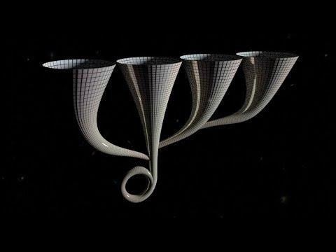

*Figure 4.1. The Gott–Li self-creating universe (image: Wikipedia).*

We know from observation that entropy increases in U⁺. In the model, entropy decreases in the Oppoverse. The model is an anti-hypersphere: in our bubble the Oppoverse is on the outside. One possibility is that all the entropy is contained within our bubble macrostate and U⁺ is perfectly insulated. Another is a Dualverse that gets smaller every time it recycles, with U⁺ not insulated. Section 13 returns to this.

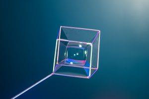

*Figure 4.2. Cube/bubble duality (image: Bazett, *The beautiful geometry of bubbles*).*

## 5. Special Relativity and General Relativity

Special relativity was essential to the construction of the Standard Model. The predictions of general relativity have been tested many times, from the 1919 eclipse to the ongoing detection of gravitational waves since 2015 [19, 20], and the Event Horizon Telescope images of photon rings around the supermassive black holes in M87 and the Milky Way confirm the theory under the most extreme conditions yet observed [21, 22]. Schwarzschild solved the field equations for a point mass in 1916 [23]; the physical meaning of the horizon and the inevitability of collapse came later [24]. Inside the horizon the Schwarzschild solution has a curvature singularity at r = 0, where the theory stops describing physics. Einstein's equations with the gravitational and cosmological constants read

Rμν − ½ R gμν + Λ gμν = κ Tμν, κ = 8πG / c⁴.

**Hypothesis H-Λ.** The model treats Λ as a variable that has grown over cosmic time. Section 15 compares this with the DESI DR2 constraints, which fix the sign of the change in the recent past.

The model's picture of gravity as the combination of a gravity field and an anti-gravity field, on the pattern of the electric and magnetic fields in Maxwell's theory, has an exact counterpart in the weak-field limit of general relativity: gravitoelectromagnetism, in which the field splits into a gravitoelectric part sourced by mass and a gravitomagnetic part sourced by mass currents [25]. With Λ included, the radial acceleration of a test body outside a mass M is

a(r) = −GM / r² + (Λc² / 3) r,

the second term being the outward push that the model attributes to the Oppoverse [26]. In the model the gravity field is generated by the Higgs mechanism and the anti-gravity field by its counterpart in U⁻. Antimatter is observed to gravitate normally: the ALPHA collaboration measured the gravitational acceleration of antihydrogen as (0.75 ± 0.13 ± 0.16) g, consistent with ordinary gravity and excluding repulsion [27]. The model's reading is that antimatter moves backwards in time and anti-gravitates, which appears as normal gravitation from our side. This reading is a hypothesis; the measurement it must survive is the next-generation ALPHA-g result at percent precision.

Singularities described as infinitely dense are taken here not to exist. If a singularity appears in the mathematics, the mathematics is incomplete. The cosmological constant problem is that field-theoretic estimates of the vacuum energy exceed the observed value by many orders of magnitude [28]. Writing a positive infinite energy density balanced by a negative infinite counter-term, E⁺∞ + E⁻∞ = E_finite, is not a resolution. The model's position is that there never was a potential for infinite energy densities; the physical quantity is the finite observed vacuum energy density, with a sign-paired partner in U⁻. In standard notation the vacuum energy density and pressure associated with Λ are

ρΛ = Λc⁴ / (8πG) ≈ 5 × 10⁻¹⁰ J m⁻³, pΛ = −ρΛ,

the numerical value following from the Planck 2018 parameters [29]. Postulate P4 identifies P⁺V⁺ with the pressure-volume product of this component on our side and P⁻V⁻ with its partner.

**Postulate P5 (mass-energy-information equivalence in U⁻).** In U⁺, mass-energy and information are distinct bookkeeping quantities: E = Mc² is not a measure of information. In U⁻ they are interconvertible at a fixed rate,

εI I⁻ = E⁻ + M⁻c²,

where εI is an energy per bit. Landauer's bound kBT ln 2 [30] and Vopson's conjectured mass per bit [31] are two candidate scales for εI.

The black hole singularity is the location where U⁺ transitions from positive mass and energy into a form of information that behaves like a fluid or plasma with negative mass. This is the model's version of dark matter as a superfluid [32], developed in Section 9. General relativity will help develop the pilot-wave model of Section 7, and the two arrows of time will produce the result of Section 13.

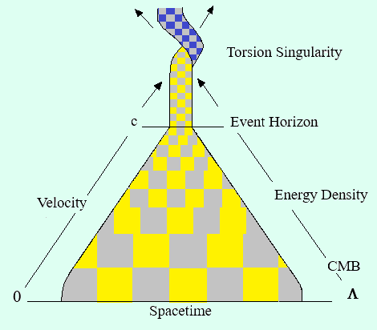

*Figure 5.1. Spacetime dilation past the event horizon: momentum carried to the torsion singularity (schematic).*

The model's proportional rates of change, explored further in Section 13, are

dV/dt ∝ dρvac/dt ∝ dPvac/dt ∝ d(Λ/κ)/dt,

with V the volume of U⁺.

## 6. Quantum Mechanics and Information

The Heisenberg uncertainty relation [33] limits the joint preparation and prediction of conjugate observables such as position and momentum:

Δx Δp ≥ ħ / 2.

The Dualverse model interprets this limit as evidence that complete Formal Information is unavailable within U⁺, but that interpretation is additional to the mathematical relation itself. To support the claim, the model must define Formal Information, show how it maps onto the quantum state, and derive the standard uncertainty bound from that mapping rather than from analogy.

As systems grow, entanglement with their surroundings suppresses interference and the classical description becomes accurate; this is decoherence [34]. Interference has nonetheless been observed for molecules above 25 kDa [35], so the quantum description is not switched off by size alone. The larger and warmer the object, the more quickly the classical relativistic solution becomes the only one that survives.

A record stores a waveform as a groove; playback recovers the waveform only within the limits set by the stylus and the groove, and no care in playback recovers detail the groove never carried. An audio recording illustrates the general idea that recording and transmission lose information, but it is not a physical derivation of the Heisenberg relation. The Dualverse interpretation requires a direct correspondence between the variables of the proposed information process and the non-commuting observables of quantum mechanics. Without that correspondence, the record example is only an intuition: information recovered from a process may be incomplete, which does not establish the form or magnitude of quantum uncertainty.

In the two-state vector formalism, a quantum system is described by a state evolving forward from its preparation and a second state evolving backward from a post-selection [36]. Weak measurements on pre- and post-selected ensembles yield weak values that can lie outside the eigenvalue range, with quasi-probability distributions that take negative values [37, 38]. The negative parts are where this framework locates the contribution of U⁻. The Heisenberg bound itself is not reduced by post-selection; it applies to the preparation, and weak values are statistical properties of a post-selected sub-ensemble.

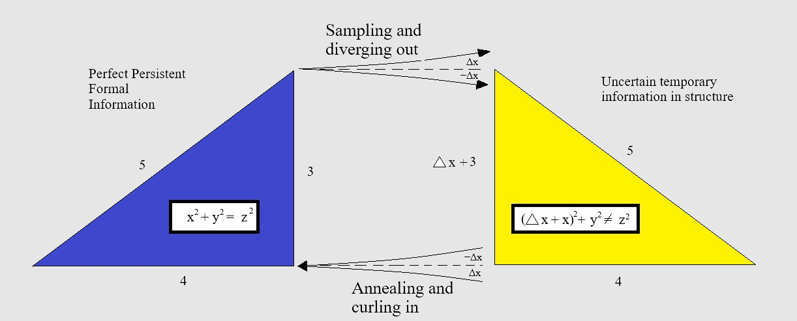

*Figure 6.1. The Pythagorean example: sampling from a perfect Form and recovering it by annealing.*

In the model, superposition is an emergent property of oscillation and does not mean that a particle is in two places at the same time; collapse is the breaking of a harmonic oscillation. Entanglement, the "spooky action at a distance", is then read as follows: Formal Information such as spin is stored in the Oppoverse, there is near-zero relative distance between any point in the small Oppoverse and any point in ours, and so correlations between entangled partners appear instantaneous at any separation. Observers and measurement have no fundamental role in quantum mechanics in this reading; the reverse dependence, of consciousness on quantum uncertainty, is left open. Entanglement is fundamental; everything is entangled with everything else to some degree, which is what the nonlocal wave function describes.

Schrödinger's cat [39] was a reductio ad absurdum aimed at the Copenhagen reading, and few physicists hold that a macroscopic cat is neither alive nor dead. The mathematics of superposition works, so the common advice is to calculate and not to interpret. The model's observation is that the standard experiments cannot distinguish a probability cloud from a real particle whose position and momentum are hidden from us; that is exactly the situation in Bohmian mechanics, where particles have definite positions and momenta and the information is carried by the pilot wave [40]. Dirac's three-polarizer demonstration [41] shows superposition of polarization states emerging from a sequence of filters; it is a textbook illustration, and the next section develops the pilot-wave reading.

The atomic electron should not be pictured as a cloud: in the model it is a real particle whose orbital motion is fast (of order c/137 in hydrogen, well below light speed) and whose uncertainty is the wave function, leading to a set of probabilistic solutions.

The model therefore invokes nonlocal hidden variables [42, 43, 44]. The apparent paradox is overcome by the overlapping asymmetry of the two realms. The likely form of information storage in U⁻ is chained anti-qubits; approaching the rest energy of the Oppoverse, the number of links increases with correspondingly increasing error correction. These nonlocal hidden variables serve as the guidance equations of the pilot-wave theory in Section 7. In effective field theory the cutoff can be set at the Planck energy; below that line physics is understood, above it quantum effects dominate and little is known. No measurement reports an exact value: both galactic-scale and quantum-scale quantities are reported in scientific notation with an uncertainty, and a report without an error bar is not a scientific result. The exceptions are counts of individual things, which can be exact small integers.

Complex numbers have a fundamental role in quantum mechanics rather than serving as a placeholder in Schrödinger's equation. Renou and collaborators showed that real-number quantum theory makes different predictions from complex quantum theory in network experiments, and the experiment favored the complex theory [45, 46]; the generality of this conclusion is debated. For this framework the occurrence of i in the equations is evidence of a dual nature of things. The duality a + bi is read as a fundamental property of the Universe: both parts are needed, and two different things combine into the thing we observe. Figure 6.2 is an abstract rendering, as two interlinked Möbius strips, of a knot motif carved as graffiti in a medieval crypt; the idea is old, and this paper aims to make it more tangible and more durable. The objection raised here against string theory is that a single type of one-dimensional object, with a landscape of possible vacua, can be fitted to almost any outcome and therefore constrains little [47].

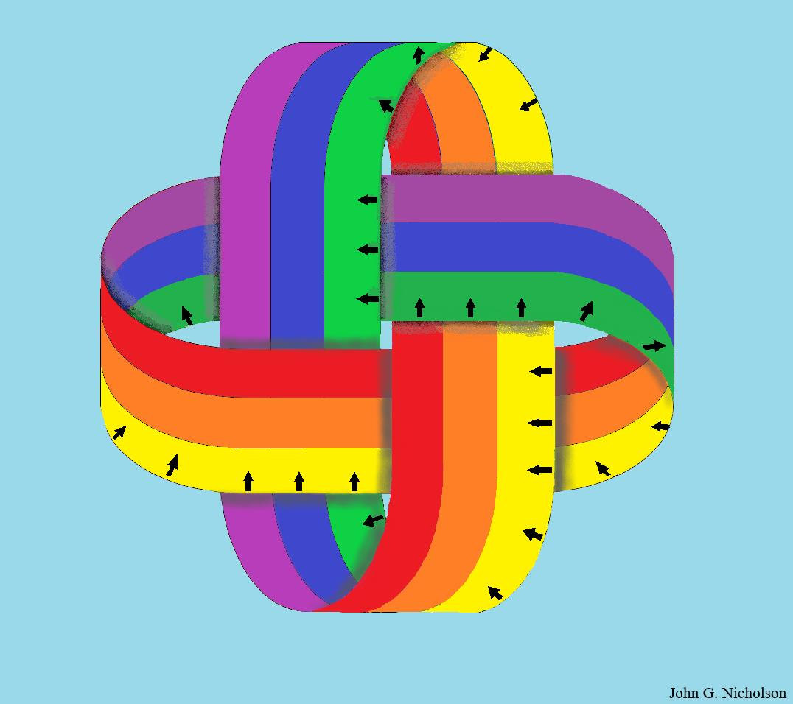

*Figure 6.2. Dual spinor/twistor as two interlinked Möbius strips.*

Our Universe creates structure, and temporary information is embedded in that structure. When structure is deconstructed in a black hole into qubits of information, those qubits are refined and converted into Formal Information, which is used to construct the Forms in the Oppoverse. The Forms are the fine-tuned preconditions, and they become the initial conditions for the next Dualverse wave function. This is a form of cosmological natural selection [48], implemented like a genetic algorithm. The refining process resembles the smoothing at the bounce of cyclic models [49, 50]: measure, refine, repeat, to the cosmic qubit.

Anti-qubits are cloneable by axiom and are cloned as qubits in mirror image, a geometric process. The information is described as qubits on the surface of a sphere. To keep ordinary qubits in superposition they must be cold; the accretion disk is hot, so superposition does not survive there and information is not retained in the disk. In the Oppoverse, antimatter is in superposition and represents our qubits while being very hot, which is the reverse of what we expect on our side. Atomic clocks, the best clocks we have, work on a hyperfine transition of the caesium atom and deliver time in discrete, countable cycles, which is what quantum mechanics needs. Spin is intrinsic angular momentum; chirality and helicity describe the handedness of a particle's internal structure and of its motion, and the model treats the handedness as the geometric content of spin.

**Hypothesis H-ν (neutrino as information carrier).** The products of the transition pass to free states of antimatter particles chained together in a double helix as anti-qubits; the transition creates Formal Information, and creating Formal Information creates energy in the Oppoverse. The neutrino is the information-carrying particle of a neutrino information field: every neutrino is entangled with an antineutrino in the Oppoverse through a neutrino connection field dating from symmetry breaking, and at the black hole singularity the Formal Information carried by the neutrino is collected.

Neutrinos stream from stars as a record of the fusion processes inside them, and they pass through planets and stars almost without interacting. In the model, the information from a rare neutrino collision is computed in the Oppoverse through the entangled antineutrino, somewhat as a radar return is read, or more closely as a hole in Dirac's hole theory. The neutrino is thus treated as the information carrier, in the way that bosons are force carriers. Laplace's demon, given the neutrino background, could reconstruct the past from the neutrino species and momentum vector: the neutrino is the accountant of a previous event, a permanent record. In this framework, species and vector are hypothesized to be sufficient for reconstruction.

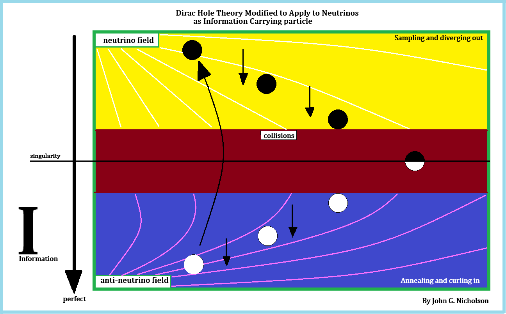

*Figure 6.3. Dirac hole theory applied to neutrinos as the information field (schematic).*

The momentum of a neutrino in Figure 6.3 records what and where, but not directly when. Where and when are linked in an expanding Universe. Neutrinos oscillate between flavours with a period set by their energy and mass-squared differences, like a pendulum with three arms of different length; the oscillation phase could serve as a kind of timestamp, which is information the carrier would need. Chirality acts like a gate design that limits interaction.

The neutrino is the receipt. In a black hole, the model transitions it to its antineutrino partner, twisted inside out with chirality reversed. The partner is created as an anti-qubit, anti-qubits are cloneable by the Oppoverse axiom, and the cycle may begin again as what we call quantum fluctuations of the vacuum. Genetic algorithms are the right mental model.

The neutrino's vector points back to the event that created it. Several computational theories of physics work well as descriptions: Wolfram's project reproduces much of the structure of physical law from simple rules applied many times [51], and Tegmark proposes that mathematical structure is the underlying essence of the Universe [52]. In the model these ideas work because the Oppoverse operates computationally; in the analog U⁺ we measure what the quantum-computational U⁻ computes, and the computation is powered by transitioned positrons. The author's picture of U⁻ is closer to a network than to a serial computer.

U⁺ could then be the result of measuring a separate computational realm, after Plato. The information in U⁺ is temporary; mass may be created by combining energy and information in U⁻, where the Formal Information resides. Reading, relaying or erasing information requires energy [30], and since energy is related to rest mass, mass should be related to information in some way. In the model the relation is carried by the neutrino connection field: neutrinos have mass and energy, and only in the context of the connection field does the mass-energy-information equivalence of Postulate P5 hold [31]. Every neutrino is entangled with an antineutrino from symmetry breaking. At the Big Bang, energy and information combine to form mass: primal matter, half matter and half antimatter, where the equivalence is most explicit. There are then two types of information, perfect and permanent Formal Information, and uncertain temporary information held in structure, completing the dual description:

- Mass: rest mass and momentum.
- Energy: potential energy and kinetic energy.
- Information: Formal Information, and informal temporary information.

## 7. Particles and Pilot Waves

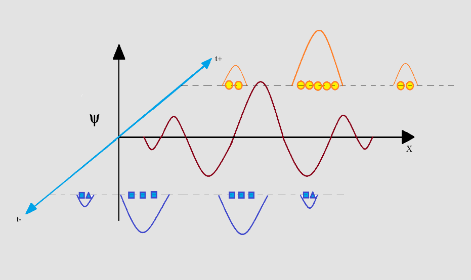

*Figure 7.1. Back-reaction and hidden-variable exchange between wave and particle (schematic).*

The paper adopts a nonlocal pilot-wave interpretation because Bell-type results exclude broad classes of local hidden-variable theories [43], while Bohmian mechanics provides a realist account with explicit particle configurations and a guiding wave function [40]. This choice is an interpretive commitment rather than a settled verdict: other interpretations reproduce the same experimental predictions, and the burden here is to show what additional explanatory or predictive work the Dualverse extension performs.

In the model, pilot-wave theory is right but incomplete. Hidden variables are exchanged from the wave to the particle, as in de Broglie–Bohm theory, and also from the particle back to the wave. Standard Bohmian mechanics has no such back-reaction. Hydrodynamic pilot-wave systems do: a droplet walking on a vibrating bath generates the wave that guides it, the wave carries a memory of the droplet's path, and the system reproduces a range of quantum-like behaviours [53, 54]. The model posits the same two-way coupling in the spirit of Newton's third law, with the back-reaction temporally nonlocal. Particle-wave duality and cube-bubble duality are maintained throughout, and the waves interact in a predictable way.

A distinction is needed between decoherence and collapse. Decoherence happens constantly; it is cause and effect, and it is entropy. In the model it occurs when the temporary structures of the present break down as they bend into the past. Completely destructive or constructive interference is unlikely but possible. Subatomic particles wink in and out of existence; the combined wave function of a complex system does not. The measurement problem, with its postulated collapse, is the harder question.

With Bohmian mechanics there is no need for the wave function to collapse from a superposition of many states; the mathematics is the same and the actual state of the wave is always there, hidden, combining and changing. Waves pilot isolated particles of any size, electrons and photons included. There are connection points for the force operators and bosons, and the field that develops between the bosons is the set of field lines of quantum field theory. Wheeler summarized general relativity as "spacetime tells matter how to move; matter tells spacetime how to curve" [55]. The model says the same of every field, gravitational included, in the pilot-wave reading: the wave pilots and propels the particle into a probability pattern; the particle tells the wave, as field lines, how to curve, according to its actual position, momentum, spin, charge, magnetic moment and coupling; the changed wave is updated simultaneously for all other particles, which it then pilots into possibly different patterns; and the process repeats. Where Aharonov's two-state vector formalism has a forward-evolving and a backward-evolving state [36, 38], the model calls observable reality the agreement of the past-directed and future-directed causal sets, and names this co-determinism. It modifies de Broglie–Bohm into a co-deterministic theory.

In the model, the effective strength of each field has a moderator, and the relative strength of a field is set by the effect of its moderator at a given distance. The ranges are those of the known interactions: the strong force is confined to the nuclear scale, about 10⁻¹⁵ m; the weak force acts over about 10⁻¹⁸ m because its carriers, the W and Z bosons, are heavy [56]; the electromagnetic force has unlimited range, and coherent magnetic fields exist on galactic scales; gravity, with its Λ counterpart, has unlimited range and the whole Universe for its field. The model pairs the moderators as follows: gravity is moderated by anti-gravity and vice versa; magnetism by electricity and vice versa; the strong force by the weak force, weakly, and vice versa. The observed weakness of the weak force at low energy is explained by the W and Z masses; the model's additional claim, that gravity is weak in this epoch because the moderating effect of anti-gravity is strong and of long range, is a hypothesis.

There are connection points between the two realms: gravity and anti-gravity connection points, and neutrino and antineutrino connection points. There are no connection points for the strong, weak or electromagnetic forces. We all can observe a field develop between the poles of a bar magnet. In this theory some fields develop between a pair of opposite-aspect operators, one in U⁺ and one in the Oppoverse, as between the two poles of a dipole; a particle's position in that field determines the strength of the action. The opposite-aspect particles are invisible because they have been twisted inside out, as Section 11 argues. These particles are the model's dark matter.

The holographic principle states that the physics inside a region can be encoded on its boundary [57, 58, 59]. In the model the Oppoverse is a nonlocal agent on the surface of an anti-hypersphere: it influences the interior without controlling it.

## 8. Dark Matter and Dark Energy

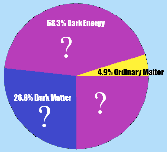

*Figure 8.1. Dark energy, dark matter, and ordinary matter and energy; Planck 2013 values [60]. The Planck 2018 values are 68.5%, 26.5% and 4.9% [29].*

Dark matter was inferred from the velocities of galaxies in clusters [61] and from flat galactic rotation curves [62] long before the cosmic microwave background was mapped; the smoothness of the background compared with the lumpiness of the present galaxy distribution then required a component that could begin clustering before recombination without scattering light [63]. Dark energy is poorly understood at a fundamental level; its required property is that it acts as a form of anti-gravity that accelerates the expansion [64, 65].

The baryon asymmetry is the problem of why any matter survived. The standard account is that the early Universe held matter and antimatter in nearly equal amounts, that almost all pairs annihilated, and that a surplus of about one part in a billion survived; the roughly 1.6 × 10⁹ photons per baryon in the microwave background are the relic of that annihilation, and producing the surplus requires the three Sakharov conditions [66, 67]. The model proposes an anti-Higgs field paired with the Higgs field, both bosons being their own antiparticles, and reads the dark components as the antimatter partner of ordinary matter, separated into its own frame and so never annihilated. On that reading the present dark-to-baryonic mass ratio of about 5.4 to 1 [29] is the antimatter-to-matter ratio of the Dualverse, and the Dualverse baryon number is conserved. Cosmic rings, if real, would be leftovers of an earlier epoch [68]. The original version of this proposal had the ratio growing from 1 to 1 toward 5 to 1 by continuing transition; Section 15 shows that the ratio was already 5.4 to 1 at recombination, so the separation must have been complete at the flip.

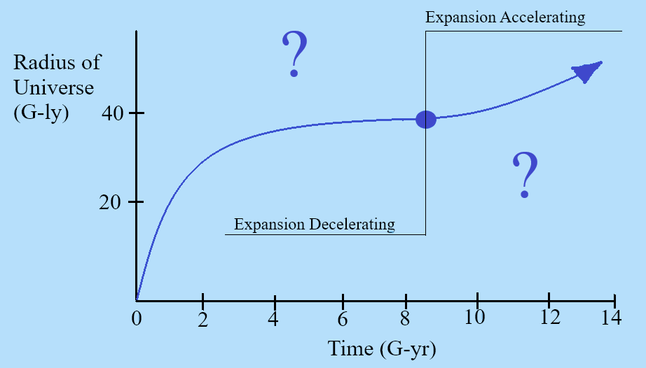

*Figure 8.2. Scale of the Universe against cosmic time (schematic). The expansion changed from decelerating to accelerating at z ≈ 0.6–0.7, about six billion years ago [64].*

**The model predicts that the relative contribution assigned to the Oppoverse is fixed at the flip and changes afterwards only by the mass processed through black holes. It further proposes two scale-dependent effects: an attractive component that contributes to galactic and cluster binding, and an expansive component associated with intergalactic pressure. To distinguish this proposal from standard dark-matter and dark-energy models, the governing equations must be specified and observations identified for which the predicted lensing, structure growth or expansion history differs measurably from ΛCDM. Section 15 begins this.**

The opposite retraction of the Oppoverse decelerates. As an overlapping closed system with two special frames of reference, only certain contributions of the Oppoverse are observable in our Universe. Ordinary matter is kept in superposition by cooling toward absolute zero. The model hypothesizes that antimatter in the Oppoverse is maintained in superposition by extreme heat, like the plasma of a stellar corona: as U⁺ cools, the Oppoverse heats. A laboratory test of this hypothesis would need a design in which the coherence of antimatter is measured as a function of temperature.

Gravitational-wave observations constrain certain dark-matter candidates, primordial black holes in particular, through the population and rate of mergers [69]; they do not measure a dark-matter density. The question the model raises is whether gravity can be unified in the way the electromagnetic and weak interactions were, by finding a relation between how the nuclear force varies with distance from the centre of a nucleus and how gravity and anti-gravity vary with distance from the centre of a galaxy. In the model, gravity on galactic scales can be calculated only once position is accounted for, through the density of dark matter as a function of position in the galaxy, which yields a ratio.

Strong lensing by substructure in galaxy clusters has been reported to exceed the predictions of ΛCDM simulations by about an order of magnitude [70]; subsequent simulation studies disagree on how much of the excess survives improved resolution [71, 72]. Lensing by ordinary matter produces caustics and a characteristic distortion pattern. The model's hypothesis is that negatively curved dark matter produces a different distortion pattern, stronger in certain regions, and that this is the source of the excess.

## 9. Superfluid and Bubbles

Compressed regions of electromagnetic and nuclear fields, layered between and in opposition to each other, may create a surface tension or buffer for the fluid of the Oppoverse. Kaluza and Klein showed how an extra compact dimension can carry electromagnetism [73, 74], and string theory extends the idea to ten dimensions; the model instead uses Felix Klein's bottle [14] as a three-plus-one-dimensional picture of the two surfaces. In the model, the surface tension keeps the dark-matter fluid from contacting ordinary matter. Any such buffer must respect the observation that dark matter passes through colliding clusters with a self-interaction cross section below about 1 cm² g⁻¹ while the ordinary gas is held back [75, 76].

On February 11, 2016, LIGO announced the detection of gravitational waves from a pair of merging black holes [19]. Separately, Farnes has worked out a cosmology in which a single fluid of negative mass, continuously created, plays the roles of both dark matter and dark energy [77]. That model has been criticized on several points, among them the shapes and masses of the halos it produces and a large-scale runaway effect [78]. For this outline it provides a worked example of a negative-mass fluid cosmology, and the criticisms of it list the problems any such model, this one included, must solve.

Can the Dualverse system be given other fluid properties, in particular surface tension? Matter in the model is the organization of energy into three-dimensional forms through multiple simultaneous entanglement arrangements. Dark matter is the equivalent unraveling of energy into no form, the untangling of time's liquid space. The Oppoverse can then be imagined as a soup of particles that contains all the information in the Dualverse, retained in the structure of chained anti-qubits. When ordinary matter is transitioned, it is like introducing new fluid into a hydraulic system. The fluid is incompressible, and because the Oppoverse is retracting, pressure builds up. The halo around a galaxy pressurizes first; then, in the space between galaxies, a hydraulic piston develops as a filament and pushes the galaxies apart. A manifold model of the hydraulic system would have low-pressure and high-pressure sides. The first requirement for bubbles is a fluid, which the Oppoverse supplies. Bubble constructs shape the design of the Dualverse, and soap bubbles are perhaps the purest demonstration of the principle of least action. The overall predicted structure is bubbles within bubbles within one big bubble (Figure 9.1).

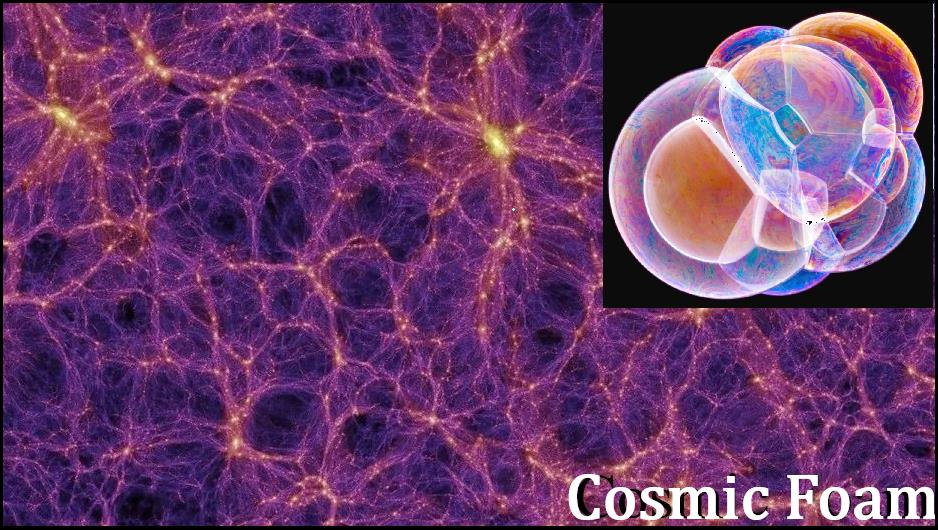

*Figure 9.1. Cosmic foam (ESA; Springel et al., Virgo Consortium) and a bubble cluster (Lawrence Lawry / Science Source).*

Soap films solve minimal-surface problems: they find the smallest area spanning given edges [79]. This helps the modeling of asymmetry. Compare the volume of liquid in a bubble with the volume of gas it encloses: in the abstract picture the liquid is the Oppoverse and the enclosed gas is U⁺. Bubbles exist under air pressure; the modified bubble diagram of Figure 9.2 shows how the model relates the two.

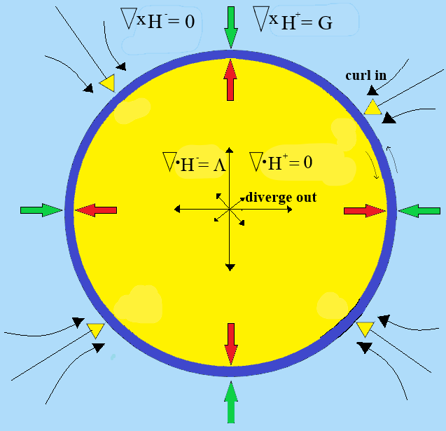

*Figure 9.2. Proposed substitution of gravitational operators for the opposing pressures of a standard bubble diagram: divergence assigned to the Λ push, curl to the gravitational pull.*

In this paper opposing gravitational fields are substituted for the opposing air pressures that maintain a bubble: gravity pulls inward and the Λ term pushes outward, like outside pressure against inside pressure. The decomposition the model needs is supplied by the weak-field limit of general relativity [25]. There the force on a test mass m moving with velocity **v** is

<b>F</b> = m (<b>E</b>g + <b>v</b> × <b>B</b>g), <b>E</b>g = −∇Φ − ∂<b>A</b>/∂t, <b>B</b>g = ∇ × <b>A</b>,

with Φ the gravitoelectric (Newtonian) potential and **A** the gravitomagnetic potential sourced by mass currents. The Newtonian field is a pure gradient, so the curl part comes from rotation and frame dragging, and the Λ term adds the outward acceleration (Λc²/3) **r** of Section 5. On the scale of galaxies and clusters the model's combined field is therefore

<b>F</b>gc = m [ −∇Φ + (Λc² / 3) <b>r</b> + <b>v</b> × <b>B</b>g ],

the divergence of the field being tied to Λ and its curl to the rotational part of gravity, as labeled in Figure 9.2.

Layers of bubble shapes can now be visualized within the Dualverse bubble, creating Plato's forms (Figure 9.3). All the Platonic solids can be made with bubbles. The model speculates that Perfection is reached when the Oppoverse crystallizes into a specific symmetric shape, behaving as a pure crystalline compound at the moment when its entropy reaches zero. This is how the Dualverse wave function is re-created.

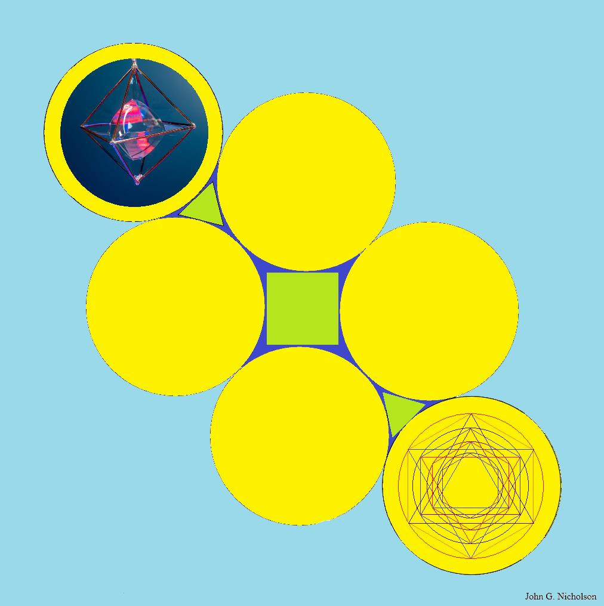

*Figure 9.3. Octahedron bubble transform (after Bazett, *The beautiful geometry of bubbles*). An abstract, not an exact representation of the model.*

## 10. Geometry and Symmetry

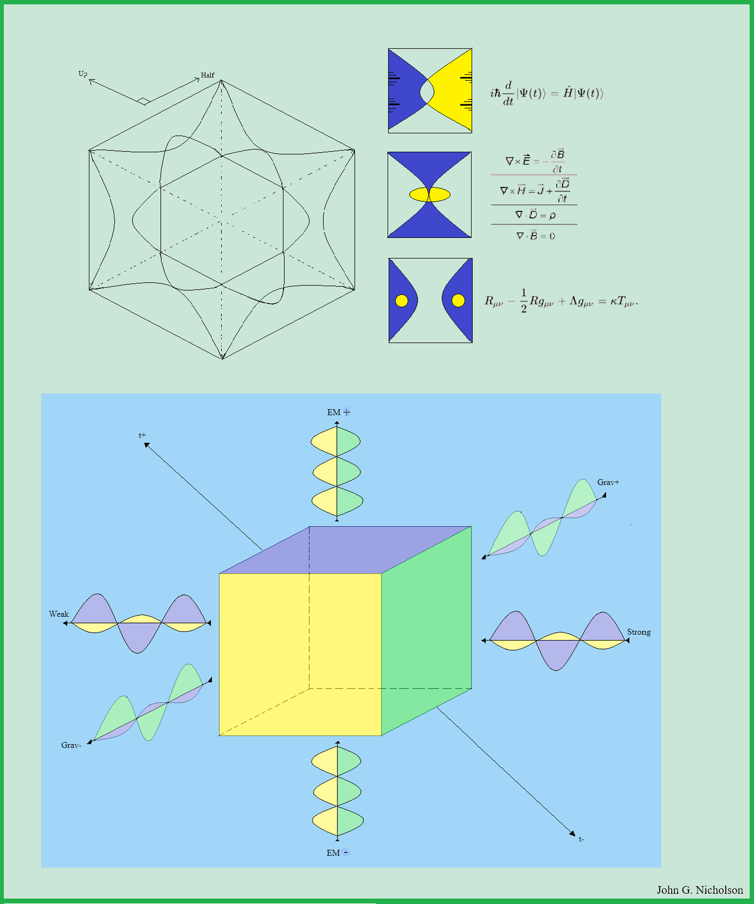

*Figure 10.1. The six tendencies acting on the cube, a shorthand symbology for the dynamics.*

The geometry of a cube is used to keep account of the forces at work on a fermion (Figure 10.1). Each of the six faces represents a degree of freedom, and transverse waves are drawn for each pair of opposed tendencies on opposite faces. The uncertainty principle enters as an angle θ off the vector on the cube. The pairing is as follows. Gravitational attraction is opposed by the repulsion of the Λ term, both present in general relativity with Λ. Electromagnetic attraction between unlike charges or poles is opposed by repulsion between like ones. In the strong interaction, confinement at long distance is opposed by asymptotic freedom at short distance. The weak interaction is not a push-pull force; it changes flavour, and the model places it, with the neutrino connection points, on the vertices rather than the faces. The face labels in Figure 10.1 (gravity, strong and magnetic forces as pulls; anti-gravity, weak force and electric force as pushes) are the diagram's mnemonic.

Pulls act between two points and pushes act outward from one point. Two masses are needed to feel gravitational attraction, at least two quarks to feel the strong force, and two poles to produce a magnetic field. Dividing a bar magnet yields two poles down to the atomic scale, where a field cannot be produced without both poles. Dirac's theory permits magnetic monopoles, none has been observed, and inflation is the standard explanation of their absence [80]. The model's reading is that forces act between pairs: one is none, two is one.

Gravity pulls matter into the cube and the Λ term pushes matter out, expanding spacetime, as in the bubble of Section 9. Consider a collapsing Universe against an expanding one: at different scales in four-dimensional spacetime it may be hard to tell whether the net action on a system is a pull from gravity or a push from anti-gravity. It is not the same river ten metres downstream. The same logic generalizes the other forces, and sharing an adjacent face produces a symmetry.

The strong force binds the quarks in the nucleus. Electrons are bound to the nucleus by the electromagnetic force and kept at a distance by the uncertainty relation and the exclusion principle. Positive charge pushes charge out of the cube and negative charge pulls it in. The vertices of the cube are the two graviton connection points, the two photon connection points, the two neutrino connection points and the two gluon connection points. A box wave has six degrees of freedom but only three at the same time, and eight vertices, the neutrino operating on two of them. The sum over the three degrees of freedom uses the following quantities: λ₁ = ± wavelength of the electromagnetic force, λ₂ = ± wavelength of the nuclear force, λ₃ = ± wavelength of the gravitational force, f = v/λ = 1/T the frequency, T the period, v the phase velocity of the box wave in the medium, and h Planck's constant.

Dirac's three-polarizer discussion [41] shows that light passed through a vertical and then a diagonal polarizer is in a superposition of vertical and horizontal eigenstates. The model extends superposition to all the forces through the box-wave description: the six degrees of freedom reduce to three sums of negative and positive contributions below a critical temperature, and above it they come together into superposition and define one of three symmetries.

The cube can represent electroweak symmetry and its breaking. Above a temperature of order 10¹⁵ K, corresponding to energies above about 160 GeV, the electromagnetic and weak interactions are a single interaction; below it the Higgs mechanism gives the W and Z bosons their masses and the two interactions separate [81, 82, 83]. The strong interaction is present throughout; its confinement transition at about 150 MeV is a separate, later event. The model's extension is a gravito-strong symmetry: if gravity can perform the same action on quarks as the strong force, there may be a symmetry between them at still higher temperature, and the conditions for it may now exist only in the Oppoverse. A third implied symmetry, between the Λ repulsion and magnetism, is possible on the cube; no observation supports it at present.

If gravito-strong symmetry and its breaking could be described, the forces would be unified as degrees of freedom of the cube, since electroweak symmetry and its breaking are already described. The model hypothesizes that the conditions for gravito-strong symmetry existed at the high temperatures shortly after the Big Bang.

Matter moving at velocities much lower than c clumps into spheres and moves in elliptical orbits. Radiation moves in straight lines at c. The model confines these vibrations, generalized over the three dimensions of space, to cubic geometry as they propagate through spacetime [84]: transverse box waves propagating along the fourth dimension, time.

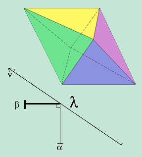

*Figure 10.2. Transverse wave transformation: quanta.*

Particles can also be diagrammed with cubic geometry. The stable proton and the unstable neutron are each three quarks; in the model's geometry three octahedra come together as a nucleon, and three more complete the cube. Edges are smoothed to spherical geometry for matter. For matter and radiation alike, behaviour is dictated by the principle of least action, which then dictates geometry. Cube-bubble duality is demonstrated by the transverse-wave transformation to an octahedron. At least two quarks are needed for this type of matter: one is none, two is one.

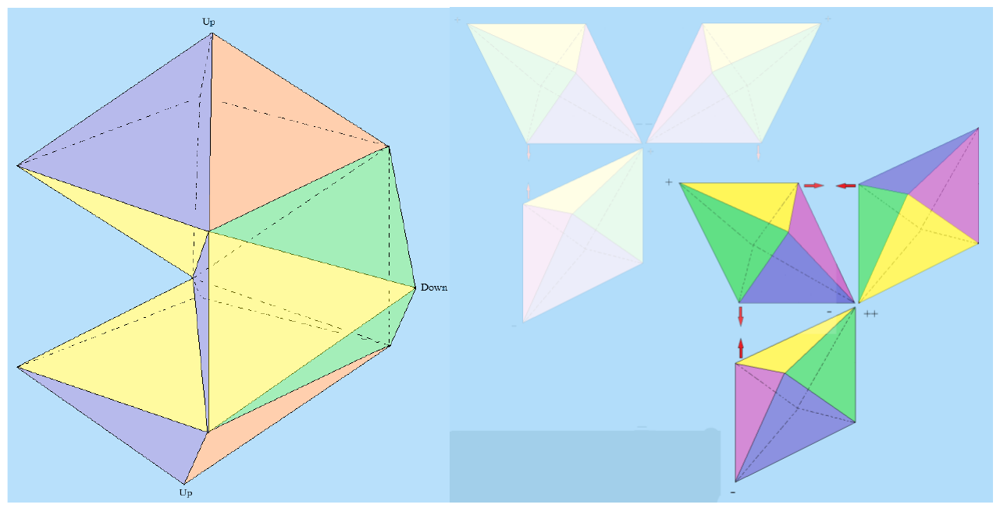

*Figure 10.3. The octahedron quark as the stable proton, with an abstract QCD illustrated.*

## 11. Curvature and the Sine Wave

The flatness problem is that the spatial curvature of the Universe is measured to be zero within a fraction of a percent, Ωk = 0.0007 ± 0.0019 [29], a value that an unadjusted expanding universe would have moved away from quickly. The horizon problem is that the microwave background is uniform to one part in 10⁵ across regions that had no causal contact in the standard expansion history. The model reads both as follows. Time is responsible for the flatness and the Lorentz invariance we observe [85]: spacetime is stretched tight, and the tension allows temporary structure to form from the arrow of time running in both directions at once. Positive space is positively curved and negative space negatively curved, and the two cancel to apparent flatness at the tangent point: 1 + (−1) = 0, sphere plus saddle gives plane. This is a heuristic; the curvatures of distinct manifolds do not add, and the model owes a construction in which they do.

The exclusion principle [86] and the sizes of atoms show that solid matter is mostly empty space. The region the quarks occupy in a nucleus is much larger than the quarks themselves, and the electron shells occupy far more space than an isolated electron. This makes an inner dimension that is negative not only plausible but, in the model, inevitable. Our observation point is a mass of positive curvature, the Earth. If we could see the Oppoverse we would be looking at a bubble from inside the bubble. Imagine Schrödinger's living cat observing the box from the inside while standing on a ball: it perceives the positive curvature of itself and of the ball through its feet, and not the negative curvature of the dark box, which it has no light to illuminate. We have no light source that illuminates dark matter.

In the standard account dark matter is dark because it does not couple to light. The model's hypothesis is different. Ignoring diffusion and polarization, the curvature of an object affects how light is reflected or transmitted from it; compare concave and convex mirrors. Stars and planets are spheres, positively curved, and act as convex sources; galaxies are disks and ellipsoids built of such spheres. Negatively curved dark matter would radiate as if from a concave mirror, directing light to a focal point and then away at an angle. Unless the Earth sits at one of these focal points, light from the dark matter never reaches it. Even a small negative curvature would make dark matter invisible or only partially visible, and the observability would be sharply position-dependent. If a patch of negatively curved space can be found and a focal point located and occupied, dark matter might be observed directly (Figure 11.1).

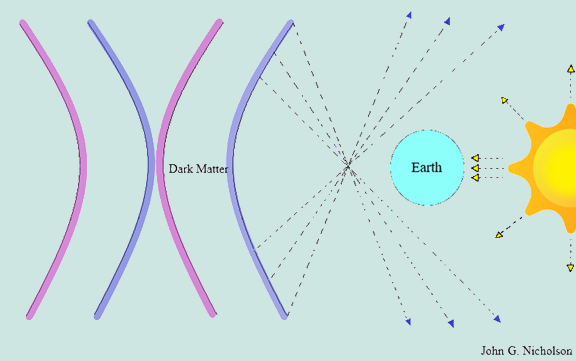

*Figure 11.1. Invisible, negatively curved dark matter detectable at focal points as the strongest cosmic rays (schematic).*

The same logic gives a hypothesis for the sources of ultra-high-energy cosmic rays [87, 88]. A concave source focuses its energy into focus points where the energy is amplified many times. Such temporary, wispy focus points would be generated at random in the outer regions of the galaxy, and a detector that passes through one records amplified cosmic rays of Oppoverse origin. The ankle of the cosmic-ray spectrum lies near 5 × 10¹⁸ eV [88]; in the model these are dark-matter collisions in the halo, condensing and falling out. An antihelium nucleus at an arbitrarily high Lorentz factor colliding with a nitrogen nucleus reaches the ankle energy easily. The Pierre Auger Observatory has measured a dipole anisotropy of about 6.5% above 8 × 10¹⁸ eV and an indication of correlation with nearby starburst galaxies [89, 90]; the focal-point hypothesis must reproduce both. Ultraluminous X-ray sources, listed together with cosmic rays as unexplained in an earlier draft [91], are understood as super-Eddington accretion onto neutron stars and black holes [92].

Flatness is a property of the present. A temporary structure created in our Universe is created with flat geometry, and that structure breaks down as the flat curvature falls off toward negative or positive curvature with time. This is entropy: the structure is shaken out.

Free neutron decay is described by the weak interaction, a down quark converting to an up quark with emission of a W⁻ that becomes an electron and an electron antineutrino; the lifetime is close to 880 seconds, with a four-sigma disagreement between beam measurements, 887.7 ± 2.2 s, and bottle measurements, 877.75 ± 0.3 s [93, 94]. The model adds a geometric reading: the left-handed neutron with its open geometry is negatively curved and unstable, and is pulled and twisted to the positive curvature of the right-handed proton by the resonating, unconfined vibrations of a down quark with missing strong connection points. The neutrino acts as the accountant, logging the information of the event. Figure 11.2 is the Feynman diagram updated to show curvature and chirality.

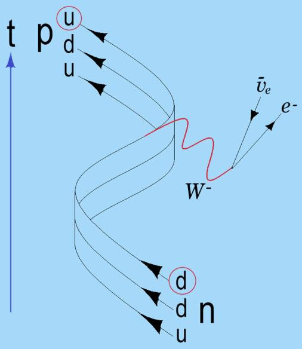

*Figure 11.2. Proposed updated Feynman diagram of neutron decay indicating curvature and chirality.*

Fourier transform the Dualverse wave function into component sine waves and graph one (Figure 11.3). On the x-axis is wavelength, with the origin at the Planck length; on the y-axis positive and negative energy. The first peak in the positive quadrant is in the infrared of the visible U⁺; the first peak in the negative quadrant is in the ultraviolet of the Oppoverse.

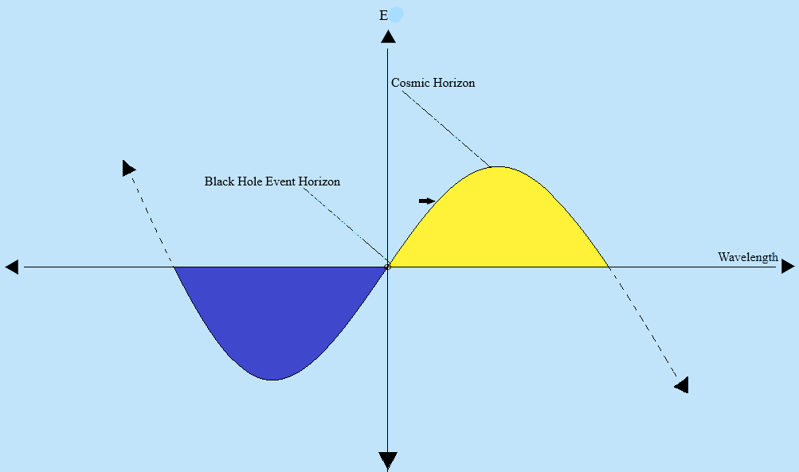

*Figure 11.3. Fourier transform and graph of the sine function of the Dualverse, origin at the Planck length (schematic).*

When the wave function is graphed as a sine wave, both the positive and negative parts count. The action is not completely described unless the negative and the positive contributions each influence a particle at a given point in spacetime, as the cube of Section 10 shows. The graph also frames infinity: the infinite bigness of the Dualverse and the infinite smallness below the Planck scale are treated the same way. The sine wave continues and perhaps repeats, a series of waves of bigness and smallness. There is no infinity here, only repetition; nothing is infinitely big or small, only relatively so, depending on the observation position, which lies between the singularity and the crest. We cannot see past a black hole's event horizon any more than we can see below the Planck scale, and we cannot see over the crest, so we cannot know how large the whole system is. The change in slope near our position must be exceedingly small.

Place a black hole at the origin as the singularity. A ball at the top of the sine wave keeps its spherical shape; rolling down toward the black hole it is stretched into a line at the singularity, where there is a twist and a phase change. The plasma's torsion momentum is conserved into the Oppoverse as negative curvature until it stretches out again to the rest energy of the Oppoverse, as an inverse box wave.

## 12. Beyond the Standard Model and the Big Bang Theory

The Standard Model describes the known particles and their electromagnetic, weak and strong interactions within relativistic quantum field theory [56], with the electroweak unification of Glashow, Weinberg and Salam at its centre [81, 82, 83]. It does not describe dark matter or dark energy, and it does not include gravity; it lacks a unified theory of mass that includes the dark sector. The difficulty, in the model's reading, lies in treating the cosmos as a symmetric system. The two realms are asymmetric in content; what is symmetric is their proportional rate of change.

Why there are three generations of matter is an open question. The model's answer is self-similarity across scales: more generations are expected at other scales, at higher energies below the Planck energy, possibly where supersymmetry is found. The model also hypothesizes, as in Section 9, that galaxies are scale-invariant particles, another generation of matter at the large end. We are looking both bigger and smaller.

<table class="axioms">
<thead><tr><th>Our Universe U⁺</th><th>The Oppoverse U⁻</th></tr></thead>
<tbody>
<tr><td>Cold before the Big Bang, gets colder</td><td>Hot before the Big Bang, gets hotter</td></tr>
<tr><td>Low mass and low energy before the Big Bang</td><td>High mass and high energy before the Big Bang</td></tr>
<tr><td>Entropy increasing</td><td>Entropy decreasing</td></tr>
<tr><td>Expansion accelerating</td><td>Contraction decelerating</td></tr>
<tr><td>Large relative potential size</td><td>Small relative potential size</td></tr>
<tr><td>No Formal Information</td><td>Formal Information</td></tr>
<tr><td>Standard laws of physics</td><td>Complementary laws of physics</td></tr>
<tr><td>No particle faster than light</td><td>No particle slower than light</td></tr>
<tr><td>"Positive" arrow of time</td><td>"Negative" arrow of time</td></tr>
<tr><td>Normal gravity</td><td>Anti-gravity; time reversal counters it</td></tr>
<tr><td>Cause leads to effect</td><td>Retro-causality; time reversal counters it</td></tr>
</tbody>
</table>
*Table 12.1. Oppoverse axioms.*

Table 12.1 sets out the properties of the two realms; in constructor-theoretic language they are the constructors of the model [9]. What are the strangest predictions of physics? Before the Big Bang, U⁺ had the potential to become exceptionally large but had low mass and energy; the Oppoverse had small potential size, high mass and energy, and complementary laws. In the Oppoverse, time reversal counters anti-gravity and counters retro-causality. The arrows of time point in opposite directions at the same time, so the model accommodates determinism in both temporal directions, as the two-state vector formalism does.

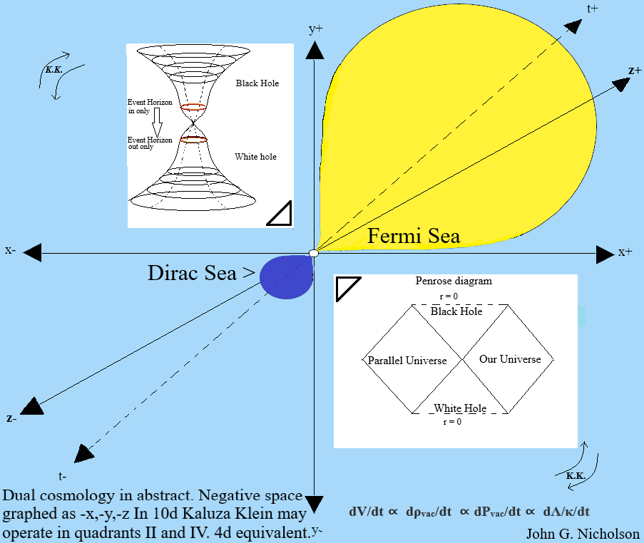

*Figure 12.2. The Dualverse parts, including the Penrose transition (schematic).*

Figure 12.2 illustrates our Universe and the Oppoverse as an asymmetric pair with the singularity at the origin; the singularity can be visualized as a pivot point, and the figure is an unfolded view of a system that is an anti-hypersphere. A symmetry can be drawn along the axis of time in the negative and positive directions. Noether's theorem associates a conserved quantity with every continuous symmetry of the action, energy with time-translation symmetry in particular [95]. The model's symmetry in the time axis is read as an indication of a repeating cycle, and of a conserved quantity associated with it.

## 13. Dual and Cyclic Cosmology

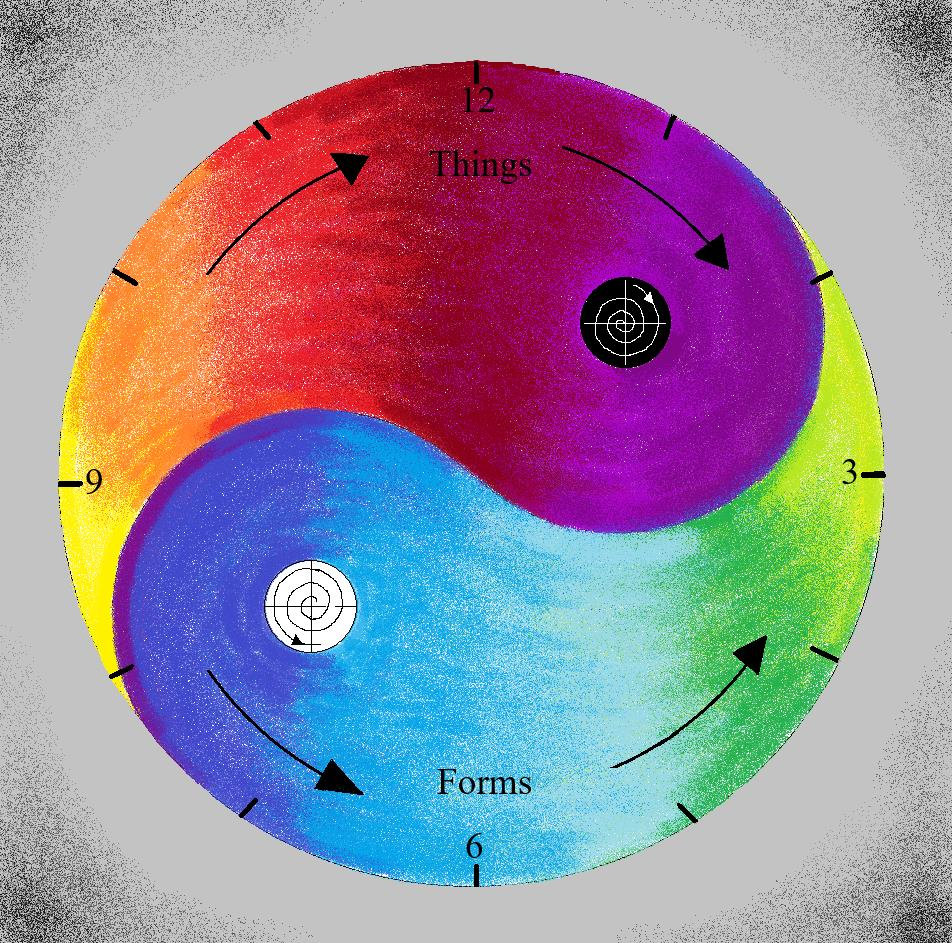

*Figure 13.1. The cyclic Dualverse flux with a Poincaré stable spiral source and sink.*

Is the system a Poincaré stable spiral sink and a stable spiral source together, one stable system with flux? The Big Bang theory was mostly right. Was the Big Bang in our Universe the result of entropy reaching zero in the Oppoverse, that is, of Perfection? Where did the material that expanded in the Big Bang come from? Did it come from the Oppoverse? How does U⁺ end, and does it recycle? Does the Oppoverse absorb the leftover disorganization of space when perfection is achieved? In the model, when entropy reaches zero in U⁻ a flip is triggered, like a polar shift, throughout the Dualverse system. The two special frames of reference flip at the pivot-point singularity: what was in U⁺ now exists in U⁻ and vice versa. The disorder left over from U⁺old now exists in U⁻new and is converted into its partner dark matter or dark energy in a fraction of a second, and the Perfection created in U⁻old now exists in U⁺new. The cycle may begin again.

Mass is created by combining energy and Information in the Oppoverse. When Perfection is achieved, primal matter is created as a pure crystalline compound, in the sense of a lattice with specific dislocations [96], containing equal amounts of matter and antimatter. When the distance between anti-gravity geodesics in the Oppoverse is pushed below the Planck length, it does not collapse into a singularity; it creates an Einstein–Rosen bridge [97] in the opposite direction, into positive space, and this object appears instantly as a white hole in U⁺. There is no inflaton field in this picture. The rapid early expansion is the release of torsion: torsion was applied to a seed, the torsion shrinks the gauge through t = 0, like a blanket wrung as it passes through the singularity, and its release expands spacetime rapidly for a brief period and then stops (Figure 13.3). The existing mathematics closest to this picture is the Einstein–Cartan theory, in which the coupling of torsion to spin produces a nonsingular bounce that replaces inflation [98] and allows a universe to form inside a black hole [99]; loop quantum cosmology gives a bounce by a different mechanism [100]. There was a bubble of space that flipped together with the crystal; it has an initial conserved velocity near light speed, gravity is not there to slow it, and the torsion angular momentum carries through.

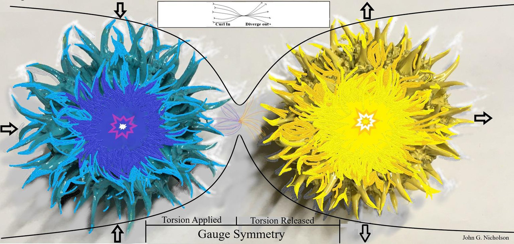

*Figure 13.2. The torsion singularity.*

The torsion momentum of the inward-contracting Oppoverse is conserved as the outward-expanding U⁺ (Figure 13.2). The same process forces the object into the most uniform shape the Universe can have, a homogeneous sphere of energy plasma. The dislocations in the original crystal lattice become the quantum fluctuations in the plasma, which become the Forms, the fine-tuned presets. This process may have evolved over many thousands or millions of iterations, a cosmological natural selection [48] for which genetic algorithms are the simplest working example [101].

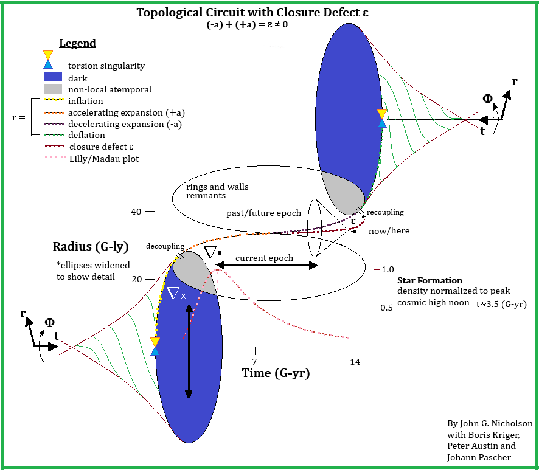

*Figure 13.3. Topological circuit with closure defect ε (by John G. Nicholson with Boris Kriger, Peter Austin and Johann Pascher). The star-formation curve is the Lilly–Madau plot [102].*

The torsion is responsible for the initial flatness, as a scalar tension; when the primordial direct-collapse black holes [103] start pulling, they retain the tension like a three-dimensional tennis racket.

Time was not a relevant quantity until baryogenesis; then time was in effect for the nuclear force. The Higgs boson is its own antiparticle, like the photon, and has a similar relation to time: temporally nonlocal, atemporal, with back and forward making no difference. Temperature, volume and momentum were the dominant characteristics, and there was no definite arrow of time; it pointed in all directions. A fission bomb relies on a perfectly shaped charge that directs all its energy into one spot. The opposite is a perfectly shaped object that directs all its energy outward with perfect uniformity so as to avoid annihilation. In the standard account nearly all quark-antiquark pairs annihilated and left the 1.6 × 10⁹ photons per baryon of the microwave background [67]; in the model, the antimatter partner of the surviving matter avoided annihilation because it was already separated into the other frame at the flip (Section 15). Things then cooled enough for the atom to exist, and there is no further annihilation from that point as the atoms are separated into two inertial frames of reference.

Before this the arrow of time has no direction. The birth of the atom brings the positive and the negative arrow of time into being simultaneously. Positive and negative curvature become defined at the surface of last scattering, about 379,000 years after the flip [29, 104]. Time begins moving forward in U⁺ and backward in the Oppoverse, and this is the decoupling: matter and antimatter separate into two inertial frames that interact only through gravity. In the model the two charged, moving frames produce electromagnetic forces as Kaluza–Klein pockets of insulating energy. A higher-dimensional version of the construction exists [13]; the model works on the bounded three-dimensional Klein bottle.

The microwave background has hot and cold spots. Their standard description is acoustic oscillation in the photon-baryon plasma [105]; the Cold Spot anomaly, aligned with a supervoid, is a separate puzzle with proposed inflationary and void explanations [106, 107, 108]. The model's reading is that cold spots show where dark matter has phase-shifted into the Oppoverse and left a void. The temperature of the background was first estimated at about 5 K by Alpher and Herman in 1948 [109]; Gamow's later estimates ran higher, up to 50 K [110]; the measured value is 2.7255 K [111]. The early estimates differed from the measurement because the baryon density and the expansion history were then unknown, and the difference carries no information about antimatter. The Dualverse evolved from equilibrium into a dark-energy-dominated state [104]. The model's proportional relation is that the rate of change of the volume of U⁺ is proportional to the rate of change of the density ratio of the Dualverse:

dV/dt ∝ dρvac/dt ∝ dPvac/dt ∝ d(Λ/κ)/dt.

The task is to calculate ρvac(t) so that its rate equals the rate of change of the energy-density ratio while dV/dt reproduces the measured expansion. The expansion changed from decelerating to accelerating about six billion years ago [64]; the model attributes the shift to the growth of the dark sector at the expense of ordinary matter, and Section 15 states the quantitative difficulty this faces.

The recycling may carry any remaining mass and energy as information into the Oppoverse when the antimatter of the last-scattering epoch is recoupled with the leftovers of the previous Universe in one frame. Cosmic rings, if confirmed, would be too old and too large to belong to this epoch and would be leftovers of a previous one [68]. The process obeys the extended first law of Section 4. The timing of the next recycling event is set by the maximum tension, which the model does not fix; values that place the event within a few billion years are not excluded. Many models predict a slow, cold death; this one does not.

## 14. Halos and Filaments; Black Holes and Bridges

Penrose showed that once a trapped surface forms, collapse to a singularity is inevitable in general relativity under the usual energy conditions [112, 113]: the geodesics converge and spacetime, as described by the theory, ends. The model argues that spacetime does not end there: when the distance between geodesics falls below the Planck length, an Einstein–Rosen bridge is created. The bridge is a feature of the maximally extended Schwarzschild geometry [97, 114], and it is non-traversable [115].

JWST observations of compact early-universe sources, the Little Red Dots [116], constrain models of rapid black-hole growth and heavy seeds; a recent comparison finds the direct-collapse seeding models in better agreement with the observed population than light-seed models [117]. The Dualverse framework proposes that some such sources mark early matter-transition events, but this identification is hypothetical. It should be evaluated against competing explanations, inferred masses, accretion rates, host-galaxy properties and the population of intermediate-mass black-hole candidates [118]; the evidence does not by itself establish that all Little Red Dots are direct-collapse black holes.

In the model, the bridge is a non-traversable connection and transition to the Oppoverse, appearing there as a white hole. The transition is complete decay: protons and neutrons to quarks; quarks stacked as cube triplets of up and down; the triplets broken down to quark-gluon plasma, neutrino triplets and energy. Information is relayed as connection points in the neutrino connection field, and this is part of the dark matter; the kinetic energy of the chain is part of the dark energy. Electrons transition into positrons, which requires the model to state how electric charge is accounted for across the transition; this is an open item. The charged quark-gluon plasma is the model's superfluid.

Many questions concern the fluid state under relativistic conditions. Is the hypothesized surface tension adequate to prevent contact and annihilation? Does it allow a gravitational plasma torch to pierce it? At the event horizon, matter appears to an outside observer to freeze and fade; does this lead to a temporary frozen structure? The mechanics must vary with mass, as observed, and the opening may be governed by the Eddington limit [119, 120]. Why does the mass of the black hole, as measured from outside, keep increasing after the matter has transitioned? In the model the torsional twist becomes an anchor under the constant pull from the Oppoverse. The opening may be just large enough to carry a particle stream for information retention, which is how the model addresses the black hole information paradox.

The rotational, tidal and frictional forces at the centre of a black hole amount, in the model, to everything being forced inside out. Objects with three positive dimensions transition to two dimensions in the accretion disk and back to three dimensions in the Oppoverse. The disk breaks three-dimensional structure down into a two-dimensional surface, and that surface is twisted inside out onto the Klein bottle geometry, so that the inside of a black hole becomes the outside of the whole Dualverse. Holography [57, 58, 59] and the AdS/CFT correspondence [121, 122] place the information that is not lost on the horizon, a two-dimensional description of a three-dimensional interior, and in Hawking's account the horizon radiates it away over time [123]; Hawking radiation has not been observed from an astrophysical black hole, and its analogue has been observed in a laboratory fluid [124]. In the model the information instead starts on the accretion disk, where large structures begin to be broken down, which is also why the disk is so hot and bright; projected through the orifice and the singularity into the three-dimensional Oppoverse, the information is protected as well or better.

The stellar orbits tracked by the groups of Ghez and Genzel established that the Milky Way hosts a supermassive black hole at Sagittarius A* [125, 126], and the Event Horizon Telescope has since imaged its shadow [22]. Quasars are powered by accretion onto supermassive black holes [127]. In the model a supermassive black hole that eats more than it can digest becomes overcharged and its opening and transition are overwhelmed: at the singularity the liquid comes together loosely instead of spraying off, the chain of antineutrinos tangles and clumps, new ordinary matter pulled into the throat collides with the antimatter clog, and a large-scale annihilation event can occur. The model reads some gamma-ray bursts this way; in the standard account they come from collapsing massive stars and compact-object mergers, so the model owes a rate. Second, the full throat drastically increases the tidal and frictional forces in the disk, producing the active galactic nucleus. Third, there can be a deflection off the horizon as relativistic jets; the standard launching mechanism extracts rotational energy electromagnetically [128], and the model relates the jets directly to the mass and the feeding rate.

Structures at the largest scales, the large quasar groups spanning more than a billion light years [129, 130], are addressed by the model: dark energy acts as hydraulic filaments that push galaxies apart, and the formation of these filaments takes a time set by the initial conditions and evolution of the galaxies they extend from, so that ruggedness develops over time. Whether these groups violate large-scale homogeneity is disputed; the largest of them is consistent with what random fluctuations produce [131], and the model needs a statistic of its own to compare.

There is a tight relation between the mass of a central black hole and the velocity dispersion of the stars in its host bulge [132, 133, 134]; the dispersions themselves have been measured since the earliest work on external galaxies [135]. In the model this mass is related to the dark-energy push that drives expansion: there should be a relation between the central black hole and the dark-matter halo around its galaxy, and the halo takes longer to develop than the black hole, since the disk takes time to form and the converted matter travels a long way at relativistic speed with its time dilation. The black hole and its galaxy must develop together, co-dependently. In standard structure formation the halo forms first; the model's reversed order is in line with the quasars of more than ten billion solar masses found less than a billion years after the Big Bang [136, 137] and with the JWST active galaxies at z = 4–7 whose black holes are overmassive relative to their hosts [138].

How? Self-similarity across scales. The active nucleus slowly inflates the dark-matter halo around itself, as an atom fills its valence shells according to the mass of its nucleus. The outward momentum of the dark matter from the galactic nucleus plays the role that keeps electrons at a distance in the atom. Small galaxies gravitate together; larger galaxies push apart with filaments. The momentum of the dark matter carries it to the halo, where it is conserved as angular momentum, and loose, unstable orbits begin as the dark matter comes together with itself. The contracting Oppoverse allows a small pressure, enough to form a bubble. When the halo shells are full to pressure they squirt out and connect with nearby galaxies as filaments with a flow, and if the adjacent halo is also full the filament acts as a hydraulic piston. The model proposes a modified Ricci flow [139] as the mathematics to describe this (Figure 14.1).

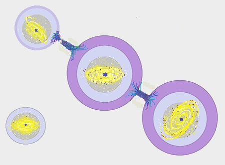

*Figure 14.1. Halos and filaments of dark matter around galaxies, with the proposed modified Ricci flow (schematic).*

In the model the central black hole ejects transitioned dark matter outward at close to light speed to the edge of the galaxy, where it joins the ocean around the galaxy in a halo with large momentum as dark kinetic energy. Every black hole in the galaxy ejects dark matter in all directions, and it inevitably reaches the halo, even when it passes through the centre. Once there it does not orbit; it joins the ocean of dark matter and energy, a liquid with surface tension, moving and loosely clumping. Outside, it shapes the galaxy into the form we observe and contributes to the accelerating expansion, like new liquid introduced into a hydraulic system. The ejected component must cool below the warm-dark-matter bound before structure forms (Section 15).

The updated thermodynamics applies to the homogeneity of the galaxy distribution in every direction. More variance would be expected from an unordered beginning. In the model, right before the Big Bang all matter was perfectly ordered, and the evidence of that order is maintained even with entropy working against it the whole time. This is why entropy is so low in the early Universe; Penrose's statement of the same puzzle is that the Weyl curvature vanished at the initial singularity [113]. The order we observe to this day is the ghost of that initial perfection. The horizon problem is addressed with the same logic: the microwave background shows a uniform 2.7255 K [111, 105], and when U⁺ first becomes visible, 379,000 years after the flip, it still shows the evidence of an earlier perfect order.

## 15. Postulates, Equations and Tests

This section collects the framework's assumptions as equations and places each next to the measurement that constrains it. The state of each realm is described by its mass M, energy E, entropy S, information I, pressure P and volume V, with superscripts + and − for U⁺ and U⁻. Postulates P1 to P5 are stated in Sections 3 to 5; P6 is new here.

**P1 (pairing).** ∀ U⁺ ∃ U⁻. A transition map T carries content of U⁺ into U⁻ and is physically realized at singularities. On the model's reading, T reverses the sign of mass, the direction of time and the chirality of every particle. The bookkeeping of electric charge under T is open (Section 14).

**P2 (extended first law).** E⁺ + M⁺c² + E⁻ + M⁻c² = constant. Work in U⁺ produces no Formal Information; work in U⁻ does.

**P3 (extended second law).** dS⁺/dt ≥ 0, dS⁻/dt ≤ 0, and d(S⁺ + S⁻)/dt ≈ 0.

**P4 (pressure-volume balance).** P⁻V⁻ = P⁺V⁺, with P⁺ = −ρΛ on our side.

**P5 (mass-energy-information equivalence in U⁻).** εI I⁻ = E⁻ + M⁻c², with εI an energy per bit.

**P6 (transfer channel).** The dark mass on our side is M⁻(t) = M⁻flip + ∫ Σi ṁi dt, the integral running over the accretion rates ṁi of all black holes since the flip, and the cosmological constant follows it: dΛ/dt ∝ dM⁻/dt.

**Hypothesis H-Λ.** Λ has grown over cosmic time.

**Hypothesis H-ν.** The neutrino is the information carrier between the realms (Section 6).

The table lists the measurements the postulates must meet.

<table class="tests">
<thead><tr><th>Quantity</th><th>Model statement</th><th>Measurement</th><th>Consequence for the model</th></tr></thead>
<tbody>
<tr><td>Dark-to-baryonic mass ratio at recombination (z ≈ 1100)</td><td>Original draft: 1:1 at the start, growing to 5:1 by continuing transition</td><td>Ωch² = 0.120, Ωbh² = 0.0224, ratio 5.4:1 required by the acoustic peaks [29]</td><td>The separation into the dark frame was complete at the flip; continuing transition is at most a small correction</td></tr>
<tr><td>Mass processed by black holes</td><td>Black-hole accretion as the main channel into the dark sector (P6)</td><td>Local black-hole mass density (2–10) × 10⁵ M☉ Mpc⁻³ [140, 141] against a dark-matter density of 3.3 × 10¹⁰ M☉ Mpc⁻³ [29]</td><td>Black holes have processed about 10⁻⁵ of the dark mass; P6 reduces to M⁻ ≈ M⁻flip</td></tr>
<tr><td>Annihilation</td><td>Original draft: no annihilation after baryogenesis</td><td>Baryon-to-photon ratio η ≈ 6.1 × 10⁻¹⁰ [29, 67]</td><td>Annihilation of the U⁺ pairs occurred; the partner that survives is the one separated into U⁻ before it</td></tr>
<tr><td>Evolution of dark energy</td><td>H-Λ: Λ grows with time</td><td>DESI DR2 with CMB and supernovae: w₀ ≈ −0.75, wa ≈ −0.86 (DES-Y5 combination), 2.8–4.2σ from constant Λ; dark-energy density rose until z ≈ 0.4 and declines since [142]</td><td>H-Λ matches the sign of the change before z ≈ 0.4 and needs a turnover after it; a constant Λ is allowed by the same data</td></tr>
<tr><td>Gravity of antimatter</td><td>Antimatter anti-gravitates while moving backward in time, appearing to fall normally</td><td>Antihydrogen falls at (0.75 ± 0.13 ± 0.16) g; repulsion excluded [27]</td><td>Consistent; the reading predicts exactly g and gains no support from a more precise measurement</td></tr>
<tr><td>Dark-matter self-interaction and temperature</td><td>A fluid with surface tension, ejected from black holes near light speed</td><td>Self-interaction cross section below 1.25 cm² g⁻¹ in the Bullet Cluster [76]; free-streaming bound equivalent to a thermal mass above 5.3 keV [143]</td><td>The fluid must be nearly collisionless, and any ejected component must cool before structure formation</td></tr>
<tr><td>Largest structures</td><td>Filaments as hydraulic pistons produce the large quasar groups</td><td>The largest group is consistent with random fluctuations in a homogeneous universe [131]</td><td>A statistic that distinguishes piston-driven structure from random structure is needed</td></tr>
<tr><td>Ultra-high-energy cosmic rays</td><td>Transient focal points of negatively curved dark matter</td><td>Dipole of 6.5% above 8 × 10¹⁸ eV and an indication of correlation with starburst galaxies [89, 90]</td><td>The focal-point distribution must reproduce the dipole and the correlation</td></tr>
<tr><td>Neutron lifetime</td><td>Decay as a chirality twist logged by the neutrino</td><td>Beam 887.7 ± 2.2 s against bottle 877.75 ± 0.3 s [93, 94]</td><td>The model can commit to which method is biased; this is its cheapest test</td></tr>
<tr><td>Cluster lensing</td><td>Negatively curved dark matter lenses more strongly in places</td><td>Order-of-magnitude excess reported [70], partly or wholly absorbed by later simulations [71, 72]</td><td>Open on both sides until the model gives a lensing map</td></tr>
</tbody>
</table>
*Table 15.1. Postulates and hypotheses against current measurements.*

Three statements can falsify the framework in its present form. First, if final DESI and Euclid data settle on a dark-energy density that never rose, H-Λ fails and with it the model's reading of the acceleration. Second, if the dark component at recombination can be shown to have the same arrow of time and the same inertial frame as ordinary matter, which the model excludes, the separation postulate fails; the cleanest version of this test is a measurement of the dark-matter equation of state and streaming velocity at last scattering. Third, if a bottle-method bias is found that closes the neutron lifetime gap and the model has committed to the beam value, H-ν loses its one quantitative handle. A prediction the corrected model does make is that the dark-to-baryonic ratio has been constant since the flip to within the black-hole correction of order 10⁻⁵; the near-constancy of the baryon fraction of galaxy clusters with redshift is consistent with this, and a future measurement of a drifting ratio would be a problem for the model.

## 16. Conclusion and Discussion

Physics describes reality, and physics is not mathematics alone; it is an understanding of physical reality that mathematics expresses. Gödel's incompleteness theorem [144], in the reading Penrose gives it [145], is taken here to mean that understanding can transcend any fixed set of rules and lets us revise them. The uncertainty attached to complex physical systems is large, and reporting it with its full error bars limits what the mathematics can claim.

The Dualverse framework remains incomplete until its qualitative claims are translated into a coherent mathematical model. Mathematics does not replace physical interpretation, but it is necessary here to define the proposed dynamics, check dimensional consistency, recover the established limiting cases and derive falsifiable predictions. The present paper is a conceptual hypothesis: it organizes possible relationships among cosmology, gravitation, thermodynamics and information, and Section 15 gives the first version of the equations and of the observations that constrain them, while the formal derivation is work in progress.

**The framework becomes scientifically useful once it can be expressed precisely enough to compare with competing models. The next priorities are to formalize the mapping T between U⁺ and U⁻, derive the conservation and evolution equations from P1–P6, identify the limiting cases that reproduce general relativity and quantum mechanics, and calculate at least one distinctive observational signature, the Λ(t) turnover of Table 15.1 being the natural first candidate. Openness to unconventional hypotheses is valuable; acceptance depends on explanatory precision, mathematical consistency and empirical risk.**

This research may lead to a better understanding of why the dimensionless physical constants have the values they do. There are likely more nonlocal phenomena like entanglement to discover. The fractal self-similarity across scales in this project may be unraveled with mathematics. Empirical evidence may be found in other branches of science: neurology, genetics, engineering, optics, fluid dynamics; research in artificial intelligence and quantum computing may yield insight. The Large Hadron Collider and experiments like it are unlikely to find evidence bearing on this paper; what is sought is more subtle. Levin's work shows that some information processes in biology are scale-free [146], and there may be a convergence between these goal-directed biological processes and cosmology: another scale-invariant process that carries information, and, in Feynman's phrase, plenty of room at the bottom [147] for a different kind of information.

The difficulty with this outline is seeing the forest for the trees. By gaining the perspective of distance, and looking with selective ignorance, the big picture can be seen all at once. If such an idea were right, the implications for science would be difficult to imagine and a path to many big questions would open, not only in physics.

The questions of life, death and consciousness were not discussed directly, but they can be freshly considered from this perspective. We are born, live and die in the shades of gray between two realms, one that we can see and one that we cannot. We grow old and die, and life is the ultimate battle against entropy. Our collective enduring science is the best expression of that battle on Earth. Scientists try to achieve perfection, and they try to order disorder, and it does not end until there is a full understanding of everything.

## Citations and References

1. Feynman, R. P. *The Character of Physical Law*. MIT Press, 1965.
2. Brandenberger, R. H. "Challenges for inflationary cosmology." arXiv:astro-ph/0411620 (2004).
3. Mach, E. *Die Mechanik in ihrer Entwickelung, historisch-kritisch dargestellt*. Brockhaus, 1883. English translation: *The Science of Mechanics*, Open Court, 1893.
4. Bohm, D. and Hiley, B. J. *The Undivided Universe: An Ontological Interpretation of Quantum Theory*. Routledge, 1993.
5. Everett, H. "'Relative state' formulation of quantum mechanics." *Reviews of Modern Physics* 29, 454–462 (1957).
6. DeWitt, B. S. and Graham, N. (eds.). *The Many-Worlds Interpretation of Quantum Mechanics*. Princeton University Press, 1973.
7. Viereck, G. S. *Glimpses of the Great*. Macauley, 1930 (Einstein interview). The same remark, from a 1927 conversation, is recorded in H. G. Kessler, *The Diary of a Cosmopolitan*, Weidenfeld and Nicolson, 1971.
8. Higgs, P. W. "Broken symmetries and the masses of gauge bosons." *Physical Review Letters* 13, 508–509 (1964).
9. Deutsch, D. "Constructor theory." *Synthese* 190, 4331–4359 (2013).
10. Deutsch, D. and Marletto, C. "Constructor theory of information." *Proceedings of the Royal Society A* 471, 20140540 (2015).
11. Croom, F. H. *Principles of Topology*. Saunders College Publishing, 1989.
12. Morgan, F. *Geometric Measure Theory: A Beginner's Guide*, 5th ed. Academic Press, 2016.
13. Greene, B., Kabat, D., Levin, J. and Porrati, M. "Klein bottle cosmology." *Physical Review D* 113, 063576 (2026); arXiv:2511.23447.
14. Klein, F. *Über Riemann's Theorie der algebraischen Functionen und ihrer Integrale*. Teubner, 1882 (the non-orientable closed surface now called the Klein bottle).
15. du Châtelet, É. *Institutions de Physique*. Prault, 1740.
16. Boyle, L., Finn, K. and Turok, N. "CPT-symmetric universe." *Physical Review Letters* 121, 251301 (2018).
17. Boyle, L. and Turok, N. "Two-sheeted universe, analyticity and the arrow of time." arXiv:2109.06204 (2021).
18. Gott, J. R. and Li, L.-X. "Can the Universe create itself?" *Physical Review D* 58, 023501 (1998).
19. Abbott, B. P. et al. (LIGO Scientific Collaboration and Virgo Collaboration). "Observation of gravitational waves from a binary black hole merger." *Physical Review Letters* 116, 061102 (2016).
20. Abbott, B. P. et al. (LIGO Scientific Collaboration and Virgo Collaboration). "An improved analysis of GW150914 using a fully spin-precessing waveform model." *Physical Review X* 6, 041014 (2016).
21. Event Horizon Telescope Collaboration. "First M87 Event Horizon Telescope results. I. The shadow of the supermassive black hole." *Astrophysical Journal Letters* 875, L1 (2019).
22. Event Horizon Telescope Collaboration. "First Sagittarius A* Event Horizon Telescope results. I. The shadow of the supermassive black hole in the center of the Milky Way." *Astrophysical Journal Letters* 930, L12 (2022).
23. Schwarzschild, K. "Über das Gravitationsfeld eines Massenpunktes nach der Einsteinschen Theorie." *Sitzungsberichte der Königlich Preußischen Akademie der Wissenschaften* (Berlin), 189–196 (1916).
24. Oppenheimer, J. R. and Snyder, H. "On continued gravitational contraction." *Physical Review* 56, 455–459 (1939).
25. Mashhoon, B. "Gravitoelectromagnetism: a brief review." arXiv:gr-qc/0311030 (2003); in *The Measurement of Gravitomagnetism: A Challenging Enterprise*, ed. L. Iorio, Nova Science, 2007, pp. 29–39.
26. Rindler, W. *Relativity: Special, General, and Cosmological*, 2nd ed. Oxford University Press, 2006.
27. Anderson, E. K. et al. (ALPHA Collaboration). "Observation of the effect of gravity on the motion of antimatter." *Nature* 621, 716–722 (2023).
28. Weinberg, S. "The cosmological constant problem." *Reviews of Modern Physics* 61, 1–23 (1989).
29. Planck Collaboration. "Planck 2018 results. VI. Cosmological parameters." *Astronomy & Astrophysics* 641, A6 (2020).
30. Landauer, R. "Irreversibility and heat generation in the computing process." *IBM Journal of Research and Development* 5, 183–191 (1961).
31. Vopson, M. M. "The mass-energy-information equivalence principle." *AIP Advances* 9, 095206 (2019).
32. Annett, J. F. *Superconductivity, Superfluids and Condensates*. Oxford University Press, 2004.
33. Heisenberg, W. "Über den anschaulichen Inhalt der quantentheoretischen Kinematik und Mechanik." *Zeitschrift für Physik* 43, 172–198 (1927).
34. Zurek, W. H. "Decoherence, einselection, and the quantum origins of the classical." *Reviews of Modern Physics* 75, 715–775 (2003).
35. Fein, Y. Y. et al. "Quantum superposition of molecules beyond 25 kDa." *Nature Physics* 15, 1242–1245 (2019).
36. Aharonov, Y., Bergmann, P. G. and Lebowitz, J. L. "Time symmetry in the quantum process of measurement." *Physical Review* 134, B1410–B1416 (1964).
37. Aharonov, Y., Albert, D. Z. and Vaidman, L. "How the result of a measurement of a component of the spin of a spin-1/2 particle can turn out to be 100." *Physical Review Letters* 60, 1351–1354 (1988).
38. Aharonov, Y. et al. "The weak reality that makes quantum phenomena more natural: novel insights and experiments." *Entropy* 20, 854 (2018).
39. Schrödinger, E. "Die gegenwärtige Situation in der Quantenmechanik." *Naturwissenschaften* 23, 807–812, 823–828, 844–849 (1935).
40. Bohm, D. "A suggested interpretation of the quantum theory in terms of 'hidden' variables. I and II." *Physical Review* 85, 166–179 and 180–193 (1952).
41. Dirac, P. A. M. *The Principles of Quantum Mechanics*. Oxford University Press, 1930 (chapter I, polarized photons).
42. Bohm, D. *Quantum Theory*. Prentice-Hall, 1951.
43. Bell, J. S. "On the Einstein Podolsky Rosen paradox." *Physics* 1, 195–200 (1964).
44. Maudlin, T. *Quantum Non-Locality and Relativity*, 3rd ed. Wiley-Blackwell, 2011.
45. Renou, M.-O. et al. "Quantum theory based on real numbers can be experimentally falsified." *Nature* 600, 625–629 (2021). The generality of the conclusion is disputed in arXiv:2504.02808 (2025).
46. Li, Z.-D. et al. "Testing real quantum theory in an optical quantum network." *Physical Review Letters* 128, 040402 (2022).
47. Smolin, L. *The Trouble with Physics*. Houghton Mifflin, 2006.
48. Smolin, L. *The Life of the Cosmos*. Oxford University Press, 1997.
49. Steinhardt, P. J. and Turok, N. "A cyclic model of the universe." *Science* 296, 1436–1439 (2002).
50. Penrose, R. *Cycles of Time: An Extraordinary New View of the Universe*. Bodley Head, 2010.
51. Wolfram, S. *A Project to Find the Fundamental Theory of Physics*. Wolfram Media, 2020.
52. Tegmark, M. *Our Mathematical Universe*. Knopf, 2014.
53. Couder, Y., Protière, S., Fort, E. and Boudaoud, A. "Walking and orbiting droplets." *Nature* 437, 208 (2005).
54. Bush, J. W. M. "Pilot-wave hydrodynamics." *Annual Review of Fluid Mechanics* 47, 269–292 (2015).
55. Wheeler, J. A. and Ford, K. *Geons, Black Holes, and Quantum Foam: A Life in Physics*. Norton, 1998.
56. Peskin, M. E. and Schroeder, D. V. *An Introduction to Quantum Field Theory*. Addison-Wesley, 1995.
57. 't Hooft, G. "Dimensional reduction in quantum gravity." arXiv:gr-qc/9310026 (1993).
58. Susskind, L. "The world as a hologram." *Journal of Mathematical Physics* 36, 6377–6396 (1995).
59. Bousso, R. "The holographic principle." *Reviews of Modern Physics* 74, 825–874 (2002).
60. Planck Collaboration. "Planck 2013 results. I. Overview of products and scientific results." *Astronomy & Astrophysics* 571, A1 (2014).
61. Zwicky, F. "Die Rotverschiebung von extragalaktischen Nebeln." *Helvetica Physica Acta* 6, 110–127 (1933).
62. Rubin, V. C. and Ford, W. K. "Rotation of the Andromeda nebula from a spectroscopic survey of emission regions." *Astrophysical Journal* 159, 379–403 (1970).
63. Peebles, P. J. E. "Large-scale background temperature and mass fluctuations due to scale-invariant primeval perturbations." *Astrophysical Journal* 263, L1–L5 (1982).
64. Frieman, J. A., Turner, M. S. and Huterer, D. "Dark energy and the accelerating universe." *Annual Review of Astronomy and Astrophysics* 46, 385–432 (2008).
65. Peebles, P. J. E. and Ratra, B. "The cosmological constant and dark energy." *Reviews of Modern Physics* 75, 559–606 (2003).
66. Sakharov, A. D. "Violation of CP invariance, C asymmetry, and baryon asymmetry of the universe." *JETP Letters* 5, 24–27 (1967).
67. Canetti, L., Drewes, M. and Shaposhnikov, M. "Matter and antimatter in the universe." *New Journal of Physics* 14, 095012 (2012).
68. Nelson, W. and Wilson-Ewing, E. "Pre-big-bang cosmology and circles in the cosmic microwave background." *Physical Review D* 84, 043508 (2011).
69. Carr, B. and Kühnel, F. "Primordial black holes as dark matter: recent developments." *Annual Review of Nuclear and Particle Science* 70, 355–394 (2020).
70. Meneghetti, M. et al. "An excess of small-scale gravitational lenses observed in galaxy clusters." *Science* 369, 1347–1351 (2020).
71. Bahé, Y. M. "Strongly lensed cluster substructures are not in tension with ΛCDM." *Monthly Notices of the Royal Astronomical Society* 505, 1458–1463 (2021).
72. Robertson, A. "The galaxy–galaxy strong lensing cross-sections of simulated ΛCDM galaxy clusters." *Monthly Notices of the Royal Astronomical Society* 504, L7–L11 (2021).
73. Kaluza, T. "Zum Unitätsproblem in der Physik." *Sitzungsberichte der Preußischen Akademie der Wissenschaften* (Berlin), 966–972 (1921).
74. Klein, O. "Quantentheorie und fünfdimensionale Relativitätstheorie." *Zeitschrift für Physik* 37, 895–906 (1926); "The atomicity of electricity as a quantum theory law." *Nature* 118, 516 (1926).
75. Clowe, D. et al. "A direct empirical proof of the existence of dark matter." *Astrophysical Journal Letters* 648, L109–L113 (2006).
76. Randall, S. W., Markevitch, M., Clowe, D., Gonzalez, A. H. and Bradač, M. "Constraints on the self-interaction cross section of dark matter from numerical simulations of the merging galaxy cluster 1E 0657−56." *Astrophysical Journal* 679, 1173–1180 (2008).
77. Farnes, J. S. "A unifying theory of dark matter and dark energy: negative masses and matter creation within a modified ΛCDM framework." *Astronomy & Astrophysics* 620, A92 (2018).
78. Socas-Navarro, H. "Can a negative-mass cosmology explain dark matter and dark energy?" *Astronomy & Astrophysics* 626, A5 (2019).
79. Almgren, F. J. and Taylor, J. E. "The geometry of soap films and soap bubbles." *Scientific American* 235(1), 82–93 (1976).
80. Guth, A. H. "Inflationary universe: a possible solution to the horizon and flatness problems." *Physical Review D* 23, 347–356 (1981).
81. Glashow, S. L. "Partial-symmetries of weak interactions." *Nuclear Physics* 22, 579–588 (1961).
82. Weinberg, S. "A model of leptons." *Physical Review Letters* 19, 1264–1266 (1967).
83. Salam, A. "Weak and electromagnetic interactions." In *Elementary Particle Theory*, ed. N. Svartholm, Almqvist and Wiksell, 1968, pp. 367–377.
84. Newsome, J. Private communication on Hamiltonians and cube geometry, 2020.
85. Lorentz, H. A. "Electromagnetic phenomena in a system moving with any velocity smaller than that of light." *Proceedings of the Royal Netherlands Academy of Arts and Sciences* 6, 809–831 (1904).
86. Pauli, W. "Über den Zusammenhang des Abschlusses der Elektronengruppen im Atom mit der Komplexstruktur der Spektren." *Zeitschrift für Physik* 31, 765–783 (1925).
87. Watson, L. J., Mortlock, D. J. and Jaffe, A. H. "A Bayesian analysis of the 27 highest energy cosmic rays detected by the Pierre Auger Observatory." *Monthly Notices of the Royal Astronomical Society* 418, 206–213 (2011).
88. Kotera, K. and Olinto, A. V. "The astrophysics of ultrahigh-energy cosmic rays." *Annual Review of Astronomy and Astrophysics* 49, 119–153 (2011).
89. Pierre Auger Collaboration. "Observation of a large-scale anisotropy in the arrival directions of cosmic rays above 8 × 10^18 eV." *Science* 357, 1266–1270 (2017).
90. Pierre Auger Collaboration. "An indication of anisotropy in arrival directions of ultra-high-energy cosmic rays through comparison to the flux pattern of extragalactic gamma-ray sources." *Astrophysical Journal Letters* 853, L29 (2018).
91. Swartz, D. A., Ghosh, K. K., Tennant, A. F. and Wu, K. "The ultraluminous X-ray source population from the Chandra archive of galaxies." *Astrophysical Journal Supplement Series* 154, 519–539 (2004).
92. Bachetti, M. et al. "An ultraluminous X-ray source powered by an accreting neutron star." *Nature* 514, 202–204 (2014).
93. Yue, A. T. et al. "Improved determination of the neutron lifetime." *Physical Review Letters* 111, 222501 (2013).
94. Gonzalez, F. M. et al. (UCNτ Collaboration). "Improved neutron lifetime measurement with UCNτ." *Physical Review Letters* 127, 162501 (2021).
95. Noether, E. "Invariante Variationsprobleme." *Nachrichten von der Gesellschaft der Wissenschaften zu Göttingen, Mathematisch-Physikalische Klasse*, 235–257 (1918).
96. Hook, J. R. and Hall, H. E. *Solid State Physics*, 2nd ed. Wiley, 1991.
97. Einstein, A. and Rosen, N. "The particle problem in the general theory of relativity." *Physical Review* 48, 73–77 (1935).
98. Popławski, N. J. "Cosmology with torsion: an alternative to cosmic inflation." *Physics Letters B* 694, 181–185 (2010).
99. Popławski, N. "Universe in a black hole in Einstein–Cartan gravity." *Astrophysical Journal* 832, 96 (2016).
100. Ashtekar, A., Pawlowski, T. and Singh, P. "Quantum nature of the big bang." *Physical Review Letters* 96, 141301 (2006).
101. Mitchell, M. *An Introduction to Genetic Algorithms*. MIT Press, 1996.
102. Madau, P. and Dickinson, M. "Cosmic star-formation history." *Annual Review of Astronomy and Astrophysics* 52, 415–486 (2014).
103. Bromm, V. and Loeb, A. "Formation of the first supermassive black holes." *Astrophysical Journal* 596, 34–46 (2003).
104. Tanabashi, M. et al. (Particle Data Group). "Review of particle physics." *Physical Review D* 98, 030001 (2018), review "Big-Bang cosmology" by K. A. Olive and J. A. Peacock.
105. Wright, E. L. "Theoretical overview of cosmic microwave background anisotropy." In *Measuring and Modeling the Universe*, ed. W. L. Freedman, Carnegie Observatories Astrophysics Series 2, Cambridge University Press, 2004; arXiv:astro-ph/0305591.
106. Cruz, M., Martínez-González, E., Vielva, P. and Cayón, L. "Detection of a non-Gaussian spot in WMAP." *Monthly Notices of the Royal Astronomical Society* 356, 29–40 (2005).
107. Szapudi, I. et al. "Detection of a supervoid aligned with the cold spot of the cosmic microwave background." *Monthly Notices of the Royal Astronomical Society* 450, 288–294 (2015).
108. Bueno Sánchez, J. C. "The inflationary origin of the Cold Spot anomaly." *Physics Letters B* 739, 269–278 (2014).
109. Alpher, R. A. and Herman, R. "Evolution of the universe." *Nature* 162, 774–775 (1948).
110. Gamow, G. *The Creation of the Universe*, revised ed. Viking, 1961.
111. Fixsen, D. J. "The temperature of the cosmic microwave background." *Astrophysical Journal* 707, 916–920 (2009).
112. Penrose, R. "Gravitational collapse and space-time singularities." *Physical Review Letters* 14, 57–59 (1965).
113. Penrose, R. "Singularities and time-asymmetry." In *General Relativity: An Einstein Centenary Survey*, eds. S. W. Hawking and W. Israel, Cambridge University Press, 1979, pp. 581–638.
114. Kruskal, M. D. "Maximal extension of Schwarzschild metric." *Physical Review* 119, 1743–1745 (1960).
115. Fuller, R. W. and Wheeler, J. A. "Causality and multiply connected space-time." *Physical Review* 128, 919–929 (1962).
116. Matthee, J. et al. "Little red dots: an abundant population of faint active galactic nuclei at z ∼ 5 revealed by the EIGER and FRESCO JWST surveys." *Astrophysical Journal* 963, 129 (2024).
117. Jeon, J., Liu, B., Bromm, V., Fujimoto, S., Taylor, A. J., Kokorev, V., Larson, R. L., Chisholm, J., Finkelstein, S. L. and Kocevski, D. D. "Little red dots and their progenitors from direct collapse black holes." *Astrophysical Journal* 998, 148 (2026); arXiv:2508.14155.
118. Caputo, D. P. et al. "On estimating the total number of intermediate mass black holes." *Monthly Notices of the Royal Astronomical Society* 468, 4000–4005 (2017).
119. Eddington, A. S. *The Internal Constitution of the Stars*. Cambridge University Press, 1926.
120. van Marle, A. J., Owocki, S. P. and Shaviv, N. J. "Continuum driven winds from super-Eddington stars: a tale of two limits." *AIP Conference Proceedings* 990, 250–253 (2008).
121. Maldacena, J. "The large N limit of superconformal field theories and supergravity." *Advances in Theoretical and Mathematical Physics* 2, 231–252 (1998).
122. Maldacena, J. "Eternal black holes in anti-de Sitter." *Journal of High Energy Physics* 2003(04), 021 (2003).
123. Hawking, S. W. "Particle creation by black holes." *Communications in Mathematical Physics* 43, 199–220 (1975).
124. Steinhauer, J. "Observation of quantum Hawking radiation and its entanglement in an analogue black hole." *Nature Physics* 12, 959–965 (2016).
125. Ghez, A. M. et al. "Measuring distance and properties of the Milky Way's central supermassive black hole with stellar orbits." *Astrophysical Journal* 689, 1044–1062 (2008).
126. Gillessen, S. et al. "Monitoring stellar orbits around the massive black hole in the Galactic Center." *Astrophysical Journal* 692, 1075–1109 (2009).
127. Lynden-Bell, D. "Galactic nuclei as collapsed old quasars." *Nature* 223, 690–694 (1969).
128. Blandford, R. D. and Znajek, R. L. "Electromagnetic extraction of energy from Kerr black holes." *Monthly Notices of the Royal Astronomical Society* 179, 433–456 (1977).
129. Komberg, B. V., Kravtsov, A. V. and Lukash, V. N. "The search and investigation of the large groups of quasars." *Monthly Notices of the Royal Astronomical Society* 282, 713–722 (1996); arXiv:astro-ph/9602090.
130. Clowes, R. G. et al. "A structure in the early Universe at z ∼ 1.3 that exceeds the homogeneity scale of the R-W concordance cosmology." *Monthly Notices of the Royal Astronomical Society* 429, 2910–2916 (2013).
131. Nadathur, S. "Seeing patterns in noise: gigaparsec-scale 'structures' that do not violate homogeneity." *Monthly Notices of the Royal Astronomical Society* 434, 398–406 (2013).
132. Ferrarese, L. and Merritt, D. "A fundamental relation between supermassive black holes and their host galaxies." *Astrophysical Journal Letters* 539, L9–L12 (2000).
133. Gebhardt, K. et al. "A relationship between nuclear black hole mass and galaxy velocity dispersion." *Astrophysical Journal Letters* 539, L13–L16 (2000).
134. Kormendy, J. and Ho, L. C. "Coevolution (or not) of supermassive black holes and host galaxies." *Annual Review of Astronomy and Astrophysics* 51, 511–653 (2013).
135. Minkowski, R. "Internal dispersion of velocities in other galaxies." In *Problems of Extra-Galactic Research*, IAU Symposium 15, ed. G. C. McVittie, Macmillan, 1962, pp. 112–118.
136. Wu, X.-B. et al. "An ultraluminous quasar with a twelve-billion-solar-mass black hole at redshift 6.30." *Nature* 518, 512–515 (2015).
137. Wang, F. et al. "A luminous quasar at redshift 7.642." *Astrophysical Journal Letters* 907, L1 (2021).
138. Pacucci, F., Nguyen, B., Carniani, S., Maiolino, R. and Fan, X. "JWST CEERS and JADES active galaxies at z = 4–7 violate the local M•–M⋆ relation at >3σ: implications for low-mass black holes and seeding models." *Astrophysical Journal Letters* 957, L3 (2023).
139. Hamilton, R. S. "Non-singular solutions of the Ricci flow on three-manifolds." *Communications in Analysis and Geometry* 7, 695–729 (1999).
140. Sołtan, A. "Masses of quasars." *Monthly Notices of the Royal Astronomical Society* 200, 115–122 (1982).
141. Shankar, F., Weinberg, D. H. and Miralda-Escudé, J. "Self-consistent models of the AGN and black hole populations: duty cycles, accretion rates, and the mean radiative efficiency." *Astrophysical Journal* 690, 20–41 (2009).
142. DESI Collaboration. "DESI DR2 results II: measurements of baryon acoustic oscillations and cosmological constraints." arXiv:2503.14738 (2025).
143. Iršič, V. et al. "New constraints on the free-streaming of warm dark matter from intermediate and small scale Lyman-α forest data." *Physical Review D* 96, 023522 (2017).
144. Gödel, K. "Über formal unentscheidbare Sätze der Principia Mathematica und verwandter Systeme I." *Monatshefte für Mathematik und Physik* 38, 173–198 (1931).
145. Penrose, R. *The Emperor's New Mind*. Oxford University Press, 1989.
146. Levin, M. "Ingressing minds: causal patterns beyond genetics and environment in natural, synthetic, and hybrid embodiments." PsyArXiv preprint, doi:10.31234/osf.io/5g2xj (2025).
147. Feynman, R. P. "There's plenty of room at the bottom." *Engineering and Science* 23(5), 22–36 (1960).
