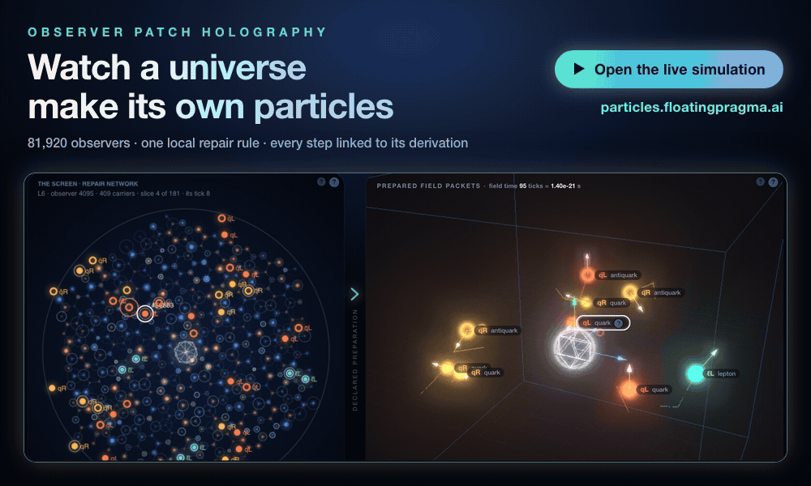

# OPH correspondence

**OPH is a rigorous, consistent and complete description of the unified, self-creating computational Universe we inhabit.**

  

<b>▶ <a href="https://particles.floatingpragma.ai/">Open the live simulation</a></b> · <a href="https://particles.floatingpragma.ai/?page=matches">All matches with our universe</a> · <a href="https://github.com/FloatingPragma/observer-patch-holography">Theory repository</a>

Notes written in reply to questions about Observer-Patch Holography (OPH). Each note
lives in its own folder with its LaTeX source and the compiled PDF, and each PDF is
also attached to a GitHub release so it can be linked directly.
The 2026-10-10 entry is an audit of a paper by an IPI member, with Markdown sources.

| Date | Note | PDF |
|------|------|-----|
| 2026-09-19 | Reconstruction from a Bounded Observer State: compression and recovery in OPH, for Stefaan Vossen | [download](https://github.com/muellerberndt/oph-correspondence/releases/download/vossen-2026-09-19/reconstruction_from_a_bounded_observer_state.pdf) · [source](2026-09-19-vossen-reconstruction/) |
| 2026-10-10 | Reconsidering Cosmic Dualism: audit and corrected edition of John G. Nicholson's two-realm cosmology paper (Markdown sources) | [paper](https://github.com/muellerberndt/oph-notes/releases/download/nicholson-2026-10-10/Reconsidering-Cosmic-Dualism-fable.pdf) · [audit](https://github.com/muellerberndt/oph-notes/releases/download/nicholson-2026-10-10/Reconsidering-Cosmic-Dualism-fable-audit.pdf) · [source](2026-10-10-nicholson-cosmic-dualism/) |

The flagship OPH paper is on PhilPapers:
[Finite Observer Consensus as a Reconstruction Principle](https://philpapers.org/rec/MUEFOC).
All OPH papers are at
[FloatingPragma/observer-patch-holography](https://github.com/FloatingPragma/observer-patch-holography).

Build a note with `tectonic <file>.tex`.
